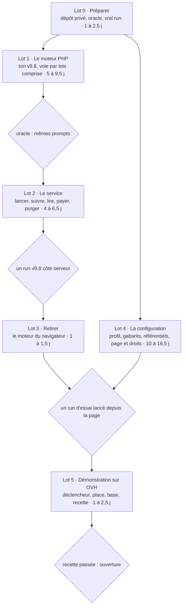

# Twin9 v9.8 : planning du moteur PHP et de la configuration

17 octobre 2026

## Le cap

Un seul moteur : ton v9.8, réécrit en PHP pour ta plateforme. Il se règle de bout en bout depuis une page de configuration, sans plafond imposé : budget et durée sont ceux que l'utilisateur choisit, ou aucun. Tout ce qui ne sert pas l'évaluation des élèves au regard du référentiel reste hors du produit.

| Directive | Ce que j'en fais |
| --- | --- |
| Partir de ton dépôt | Tout se fait dans `4nd4ny/humanome`, celui qui sert humanome.xyz, avec ta cartographie d'octobre et ton moteur JavaScript du v9.8. Le dépôt de Stéphane n'est ni forké ni modifié : on n'en reprend que des idées, réécrites, jamais de code, puisque son dépôt est privé et le tien public. Comme tu tiens Twin9 fermé pour l'instant, ton v9.8, ses gabarits et le moteur PHP vivent dans un dépôt privé, que la plateforme charge (lot 0). |
| Garder la version 9.8 | Ton Twin_v9 v9.8, réécrit en PHP fonction par fonction. Un oracle tiré de ton code vérifie, appel par appel, que le moteur PHP envoie les mêmes prompts que le tien. Écarts voulus, listés dans le test : trois correctifs du découpage (NFC, BOM, dates Google Docs), repris de Stéphane, et un défaut de ton code corrigé : une panne mémorisée passait ensuite pour un jugement. |
| Tout coder en PHP | La plateforme fait tout : comptes, configuration, exécution des runs, résultats. Ton moteur du navigateur part une fois remplacé (lot 3). Ton Python ne sert qu'hors ligne, à produire l'oracle. |
| D'abord corriger | Les corrections se font dans le port, chacune avec son test : la panne mémorisée de ton code, et quatre exigences qu'aucun moteur côté serveur ne peut négliger (une clé par run, l'identité prise dans la session, le propriétaire vérifié à chaque lecture, le modèle réellement servi relevé). |
| Lever toutes les limitations | Aucun plafond d'instruction : ton v9.8 n'en a pas, le port n'en ajoute pas. Budget et durée sont des plafonds facultatifs, « aucun » compris. Les troncatures écrites dans ton code (900 et 4 000 caractères, 15 lignes, et d'autres) font partie de l'algorithme : elles restent toutes, et deviennent des réglages. |
| Tout régler depuis une page de configuration | Chaque paramètre d'algorithme de ton `config.json` et de ta ligne de commande, plus le modèle Claude de chaque étape avec son effort et sa réflexion (les modèles 5.5 refusent toute température), le parallélisme, les clés, la voie directe ou par lots, les plafonds, le jeu de gabarits des promptologues et le référentiel des épistémiarques. |
| Être multi-référentiels | Le moteur ne suppose aucun référentiel : RESPIRE n'est que le premier publié, et chaque run choisit le sien. Ta cartographie d'octobre lit déjà le référentiel embarqué dans les données. Le planning n'en charge aucun autre ; la V18, comme les suivants, entrera par l'atelier des épistémiarques (lot 4). |
| Le minimalisme | Rien de ce que Stéphane a ajouté n'entre dans ton dépôt. Au lot 3 ne part que ton moteur du navigateur, une fois le moteur PHP en service. Pas de Docker : on développe sans conteneurs, et la démonstration reste sur ton OVH gratuit (lot 5). |

Du dépôt de Stéphane, aucun code n'entre. On en reprend des idées, réécrites : trois correctifs du découpage, les journées en parallèle, la relance qui n'instruit que les journées nouvelles, le refus d'un code de compétence hors motif.

Quatre limites restent, parce qu'elles ne viennent pas de l'algorithme : la capacité du serveur, le débit des fournisseurs, la fenêtre de contexte de chaque modèle et, avec la clé de l'instance, les crédits de l'utilisateur. Quand l'une d'elles retarde ou arrête un run, la page du run le dit (lot 2).

Ta question « pourquoi ne pas tout coder en PHP ? » tient : le moteur n'est qu'une suite d'appels d'API et d'accès à la base.

Ton dépôt a déjà ce moteur en JavaScript, au même protocole (`v9.8-contre-lecture`). Le faire tourner sur le serveur ferait l'économie du port, mais ton hébergement n'a pas de Node serveur (ADR-003), et la plateforme aurait deux langages serveur au lieu d'un. Je garde ton choix du tout PHP.

## Vue d'ensemble

Six lots, en deux colonnes qui se rejoignent à la recette de la configuration : environ 22 à 39 jours de travail, plus une marge de 20 %. Menés en deux chantiers parallèles, ils tiennent en 13 à 24 jours : le chemin le plus long passe par le moteur, le service, la cartographie à plusieurs référentiels, le retrait du moteur du navigateur et la démonstration. Les prompts qui découpent ce travail en conversations suivent le lot 5.



*Total estimé : 22 à 39 jours de travail, plus 20 % de marge ; deux chantiers en parallèle, 13 à 24 jours. Le lot 4 commence dès le lot 0 ; ses référentiels attendent le lot 1, leur recette le lot 2.*

Le moteur (lots 1 à 3) et la plateforme (lot 4) avancent en même temps : le lot 4 n'attend le moteur que pour ses référentiels, et le service que pour leur recette. Chaque losange est une porte : le lot suivant ne commence que lorsqu'elle est franchie.

## Lot 0 · Préparer

Avant d'écrire une ligne de PHP : un dépôt privé pour ton v9.8, ses gabarits et le futur moteur ; un oracle qui dit si le moteur PHP joue bien ton v9.8 ; un vrai run, réponses comprises.

L'oracle est faisable. Ton moteur JavaScript a atteint en juillet la parité à l'octet des sorties de ton v9.8 (carte, profil, appels par étape) sur six oracles simulés, sans comparer les prompts. Et le simulé de ton v9.8 est déterministe : relancé sur PLANT-01, il rend les mêmes 2 729 prompts, à l'octet. Pour le PHP, l'oracle enregistre aussi chaque réponse : le moteur PHP les rejoue, si bien qu'il n'a pas à imiter ton simulé, et compare l'empreinte de chacun de ses prompts à celle du tien.

| Tâche | Où | Fait quand | Taille | Statut |
| --- | --- | --- | --- | --- |
| Ouvrir le chantier dans ton dépôt : une branche par prompt, fusionnée dans `main` par ta pull request, comme pour la cartographie. Écrire l'ADR-011 du moteur PHP (deux ADR portent déjà le numéro 010) : exécution sur le serveur par tranches (ADR-005), Anthropic seul, moteur dans `Twin_v9` que la plateforme charge, portfolio et état du run gardés sur le serveur avec l'accord de l'apprenant, coût moyen à la place du devis par run simulé ; une ligne en tête des ADR 001, 005, 008 et 010 (Twin9) renvoie à lui. `CLAUDE.md` et `INSTALL.md` : plus de Docker en développement, PHP et MySQL locaux, Composer avec la plateforme fixée à PHP 8.2. La CI publique reçoit la suite php, avec MySQL ; celle de `Twin_v9` lance les tests du moteur sous PHP 8.2, la version d'OVH. | `docs/decisions/`, `CLAUDE.md`, `INSTALL.md`, `.github/workflows/publiable.yml`, `Twin_v9`, `STATUS.md` | Les deux CI passent ; la plateforme démarre avec et sans `../Twin_v9`. | M | À faire |
| Créer `Twin_v9`, ton dépôt privé, que tu crées sous ton compte avec ton code v9.8 tel quel à sa racine, et y verser le générateur de l'oracle : il exécute ton code en simulé, sous une version de Python fixée et à horloge figée, sur 15 scénarios, 13 de PLANT-01 (réglages, collèges, jurys, Arpenteur, reprise sur un état) et deux de SYNTH-01 et SYNTH-06, et enregistre chaque appel (chemin de son artefact, puisque tes jurés partagent une même étiquette ; étape ; empreinte du prompt ; réponse ou panne) et les sorties finales. Le dépôt se clone à côté de humanome, là où ses scripts le cherchent déjà (`gen-oracles.sh`, l'import des gabarits). | `Twin_v9` (`oracle/`) | Relancé, le générateur rend les mêmes fichiers, à l'octet. | M | À faire |
| Enregistrer un vrai run de ton v9.8 sur PLANT-01, ton portfolio synthétique, avec les modèles que tu as choisis (Haiku, Sonnet), par le backend `anthropic` de ton code et une configuration à écrire : les tiennes visent Qwen et Mistral sur le HPC, ou Claude par la ligne de commande. Chaque lecteur y porte une température de 1, la seule que Haiku 5.5 accepte. Réponses comprises : un vrai modèle répond de façon plus désordonnée que le simulé, et c'est là que les analyseurs du port se jugent. Il reste dans `Twin_v9`, puisqu'une vraie réponse peut citer un gabarit. | `Twin_v9` (`oracle/reel/`) | Le run est versé, avec ses modèles et son coût. | S | À faire |

Taille estimée en jours de travail avec Claude, relectures comprises : S deux à quatre heures, M une demi-journée à une journée, L deux à trois jours. Repère : ton portage JavaScript du v9.8, parité des sorties comprise, a pris environ une journée mi-juillet ; le port PHP, guidé par ce portage et ses vecteurs, compte donc ses étapes en M, et en L seulement ce qui est neuf.

Chaque tâche porte, dans le même commit, le test qui la vérifie ; pour le moteur, c'est l'oracle. Aucun test rouge n'est versé d'avance.

## Lot 1 · Le moteur PHP

Ton code, fonction par fonction et dans le même ordre, pour que chacune se relise contre la tienne : environ 4 400 lignes, `twin9.py` et `aurora/`, sans ton banc, tes outils HPC, ton simulé génératif ni tes visionneuses HTML. Ton moteur JavaScript sert de second guide : il a déjà répondu aux mêmes questions. L'oracle vérifie au fil de l'eau : une étape n'est finie que lorsque ses appels rendent tes prompts. Jusqu'à ce que le lancement copie le profil du run (lot 2), le moteur lit les réglages de protocole de ton `config.json`, avec tes modèles fixés dans un fichier local. Le moteur vit dans `Twin_v9` ; la plateforme le charge et lui fournit les appels aux modèles, les clés et l'état du run.

| Tâche | Où | Fait quand | Taille | Statut |
| --- | --- | --- | --- | --- |
| Les fondations : découpage en journées, avec les trois correctifs de Stéphane (NFC, BOM, dates Google Docs), réécrits d'après leur description, les fins de ligne se convertissant comme le fait Python ; référentiel et fiches ; gabarits ; lecture tolérante du JSON ; ancrage des verbatims, qui exige un port exact de `difflib.SequenceMatcher`, `autojunk` compris ; empreintes et permutations ; tirage du jury aléatoire, qui exige un port exact du générateur de Python (`random.Random`). Et tout ce que Python fait autrement que PHP, jusqu'à l'octet des prompts : `round` à l'arrondi pair sur la valeur binaire exacte (jamais le `round()` de PHP), `str()` des nombres à virgule, `json.dumps` dans le prompt du rapporteur (dictionnaire vide, clés numériques, exposants), espaces Unicode, `strip` et tranches en caractères, ordre des ensembles dans les sommes de chaleur. Tes assistants `engine/src/twin9/py/` et leurs vecteurs ont résolu ces cas en juillet : ils se portent d'abord, avec les vecteurs dont les tests ont besoin. Aucune extension qu'OVH n'aurait pas : la plateforme y emploie déjà `mbstring` et `curl`, et la normalisation NFC vient d'un polyfill si `intl` manque. | `Twin_v9` (`php/`) | Les vecteurs de ton moteur JavaScript passent en PHP ; gabarits et fiches rendus égalent les tiens, à l'octet (tests). | M | À faire |
| Les appels directs à Anthropic, côté plateforme, depuis ton `AnthropicCaller` : chaque étape choisit son modèle Claude, son budget de sortie, son effort et sa réflexion, coupée par défaut sous la forme que chaque modèle accepte (`disabled` pour Haiku 5.5 ; `between_tools` pour Sonnet 5.5, qui refuse le `disabled` qu'envoie aujourd'hui `AnthropicCaller`) ; aucune température, que les modèles 5.5 refusent. Délai et tentatives de ton code, dans la limite de la tranche ; un refus de débit attend son `Retry-After` ; un refus du modèle compte comme une panne ; modèle servi relevé. Le simulé rejoue les réponses de l'oracle. | `AnthropicCaller`, `Llm/` | Chaque requête est celle attendue (tests sur un fournisseur simulé). | S | À faire |
| La voie par lots, que tu as retenue pour un profil complet : les appels en attente de toutes les journées partent ensemble par l'API Message Batches d'Anthropic, à moitié prix, en lots bornés (une dizaine de mégaoctets, écrits au fil de l'eau), et le run reprend quand le lot revient ; ses vagues d'appels se suivant, un run par lots dure des heures. Chaque requête porte une empreinte courte de son identifiant d'appel, l'API limitant le sien à 64 caractères simples. Les lots ne se valident qu'à la fin : avant le premier, un appel direct minimal par modèle du run vérifie que l'API accepte ses réglages. Un lot perdu dans un crash est retrouvé ; une erreur serveur ou une requête expirée est resoumise ; un lot relevé est supprimé chez Anthropic, qui le garderait sinon 29 jours. C'est la voie qui convient à ton hébergement : une tranche soumet le lot et rend la main, une autre le relève. | `Llm/`, `Twin_v9` | Un run simulé par lots rend les mêmes prompts qu'en direct ; tué entre deux lots, il reprend sans rien repayer ; un lot relevé est supprimé (tests). | M | À faire |
| La journée : lecteurs et calques (archives, élagage), consensus, première impression, greffier, juge léger et ses passes, contre-lecture, suspicions, carte du jour. Les calques archivés sont rangés par utilisateur, portfolio, référentiel et jeu de gabarits. | `journee.py` → `Twin_v9` | Les appels de la journée passent l'oracle sur les 15 scénarios. | M | À faire |
| Le tribunal : composition du jury dans ses trois modes (par défaut, socle de 4 et spécialiste du pôle ; socle 2+2 ; aléatoire), accusation, défense, réplique, briefing, jurés et second tour, relance, gardiens, président et ses prescriptions, dossier vide, faisceaux. | `tribunal9.py` → `Twin_v9` | Les appels du tribunal passent l'oracle. | M | À faire |
| La fusion : fusion mécanique, second ressort, profil ipsatif, relectures (Kairos, pôles, compétences, rapporteur), gardien des formulations, sorties (`carto_evolutive.json`, `profil_ipsatif.json`, rapports, carte de chaleur), sans tes visionneuses HTML. | `merge3.py`, `heatmap.py` → `Twin_v9` | Sorties identiques aux tiennes, à horloge figée. | M | À faire |
| L'Arpenteur, à la demande comme chez toi. | `scan9.py` → `Twin_v9` | Le scénario avec Arpenteur passe l'oracle. | S | À faire |
| L'exécution, par tranches, puisque ton hébergement n'admet ni processus long ni cron : chaque tick (ADR-005, 45 s au plus) reprend les runs en attente là où ils s'étaient arrêtés, rejoue le moteur depuis le journal (une journée ou un dossier fini se relit depuis la mémoire, sans être rejoué), envoie les appels suivants, par lot ou en direct, et rend la main. Il est déclenché de l'extérieur, avec un jeton qui ne sert qu'à lui (lot 5), et par la page du run tant qu'elle est ouverte, pour les seuls runs de son propriétaire. Un seul tick tourne à la fois, sous le verrou qui existe déjà, et avance au plus N runs ; N et la durée d'une tranche sont des réglages de l'administrateur. Chaque run garde une copie de ses réglages. Chaque appel est inscrit au journal avant et après (identifiant de l'appel, étape, modèle servi, empreinte du prompt, réponse, jetons, coût, durée) ; à la reprise, une réponse ne sert que si le prompt recalculé a la même empreinte. Ce journal fait partie de l'état du run, sous l'accord de l'apprenant : ce n'est pas une journalisation, qui reste aux compteurs (ton principe 5), et un run fini n'en garde que les compteurs. Résultats et mémoire de la carte sont rangés compressés : en simulé, les 4,7 Mo de sorties d'un run de 10 journées en font 1. La mémoire de ta carte est rangée par utilisateur, portfolio, référentiel et jeu de gabarits, écrite journée par journée, et son empreinte couvre tout réglage qui change une réponse. Une panne (un appel qui échoue après ses tentatives, ou que le modèle refuse) laisse sa journée ou son dossier à rejouer au run suivant : la mémoire ne retient jamais une panne comme un jugement. Les parallélismes de ton code ne changent aucun prompt, puisque le rejeu collecte chaque vague d'appels ; deux réglages restent, les appels directs simultanés (`curl_multi`) et les journées menées de front, qui remplissent les lots. Aucune transaction ne reste ouverte pendant une attente, et l'état se charge journée par journée, dans la mémoire que permet OVH. | `Worker/Tick.php`, `Worker/JobQueue.php`, la route `worker-tick`, migration, `Twin_v9` | Un run tué en plein tribunal reprend sans appel en double ; un juré en panne est rejoué au run suivant ; un rejeu dans un ordre mélangé rend les mêmes prompts ; deux runs simultanés gardent leurs réglages et leur clé ; aucune tranche ne dépasse sa durée (tests). | L | À faire |
| L'oracle en continu : les tests de parité du moteur tournent dans la CI de `Twin_v9` ; ceux qui passent par le tick lisent `../Twin_v9` et tournent dans ta conversation de travail, qui installe MySQL ; ailleurs, ils sautent proprement. Ils rejouent quatre scénarios simulés, dont l'Arpenteur et un jury aléatoire, plus le vrai run, et comparent les sorties en JSON décodé : l'ordre d'achèvement des appels n'y compte pas. Un moteur factice, public et chargé comme le vrai, permet à la CI de ton dépôt de tester le tick, le journal et la reprise sans la v9.8. | `Twin_v9`, `api/tests/Twin9/` | Un mot changé dans un prompt les fait échouer, en moins de deux minutes. | S | À faire |

## Lot 2 · Le service

Le moteur tourne ; ce lot le met entre les mains des utilisateurs : lancer, suivre, lire, payer, purger. Les vues Twin9 de ton dépôt restent ; elles lisent désormais le serveur, et ta cartographie d'octobre affiche les résultats.

| Tâche | Où | Fait quand | Taille | Statut |
| --- | --- | --- | --- | --- |
| Lancer et suivre un run : identité prise dans la session ; profil choisi, copié dans le run avec les versions de son jeu de gabarits et de son référentiel et le commit du moteur, qui forment son attestation ; portfolio de l'utilisateur ou téléversé ; accord de l'apprenant au lancement, qui étend au stockage ton écran de consentement (ADR-010) : son portfolio et l'état du run restent sur le serveur jusqu'à ce qu'il les efface (ton principe 2). L'écran, qui promet aujourd'hui que rien n'est conservé côté serveur, ta politique de confidentialité et ton registre RGPD le disent désormais, ainsi que la conservation d'un lot chez Anthropic jusqu'à sa suppression (29 jours au plus). Progression lue dans le journal d'appels, avec ce qui retarde ou arrête le run (runs simultanés, débit du fournisseur, crédits) ; annulation, reprise ; tant qu'elle est ouverte, la page du run fait avancer les runs de son propriétaire, par une route de session. | routes `twin9.php`, `JobQueue`, `Twin9View`, `content/legal/confidentialite.md`, `docs/rgpd-registre.md` | Un run lancé depuis le front va au bout, se suit et se reprend (test de bout en bout, moteur factice). | M | À faire |
| Lire les résultats par php : le propriétaire, et le cartographe qu'il a lié, avec la visibilité qu'il choisit ; l'administrateur ne voit que des compteurs. Comme dans ton v9.8, l'élève voit le dossier complet, délibérations comprises, pour suivre le déroulé du raisonnement : ta cartographie les montre déjà pour un run AuroraCore (jury, seconde lecture), et `mapper.js` les lui apportera pour un run Twin9. Le filtre de fuite des gabarits s'applique à ce qui s'affiche. | routes php, `LeakFilter`, `ResultatsTwin9`, `mapper.js`, `web/src/carto/` | Un run du serveur s'ouvre dans la cartographie, délibérations comprises ; personne ne lit le run d'un autre (tests d'accès). | L | À faire |
| Coûts et plafonds : chaque appel débite les crédits de son auteur à l'usage réel, ta marge comprise, à moitié prix par lots ; la grille de prix couvre les modèles du profil, palier des longs prompts de Haiku 5.5 compris. Budget et durée par run, facultatifs, « aucun » possible : avant chaque envoi, le pire cas est réservé, comme le fait déjà ton crédit (ADR-010), si bien qu'un run ne dépasse jamais son budget ; atteint, il s'arrête proprement, carte marquée incomplète, reprise possible. Avant de lancer, l'utilisateur voit le coût et la durée moyens par journée des runs passés du même profil, à défaut ceux du vrai run de PLANT-01 ; ce chiffre remplace le devis par run simulé de l'ADR-010. Le premier run d'un portfolio évalue toutes ses journées. | `CreditService`, `Twin9Config`, `Llm/`, page de lancement | Un run plafonné à 1 $ s'arrête avant de dépasser 1 $, et sa carte le dit (test). | M | À faire |
| Une clé par run : celle de l'utilisateur, tirée de son coffre, quand le réglage existant `twin9_cle_perso_ouverte` l'autorise, ou celle de l'instance, lue au moment de l'appel et jamais écrite ailleurs. | `KeyVault`, `Llm/`, `Twin9Config` | Aucune clé dans le journal d'appels ni dans les sorties (test). | S | À faire |
| Relancer : un portfolio déjà évalué n'instruit que ses journées nouvelles ou changées, grâce à la mémoire de ta carte, puis la fusion se refait ; la page de lancement dit combien de journées sont nouvelles. Un retrait ne change rien : la carte reste additive, et l'interface de cartographie choisit les journées utilisées. | `Twin_v9`, page de lancement | Une journée ajoutée n'instruit qu'elle (test). | S | À faire |
| Purge et export : supprimer un compte (`DELETE /auth/account`) efface aussi ses runs, leur journal, la mémoire de ses cartes et ses lots encore chez Anthropic ; l'export du compte les contient. | `routes/auth.php`, export du compte, `docs/rgpd-verification.md` | Après la purge, aucune ligne de l'utilisateur ne reste dans les tables du moteur (test). | S | À faire |

## Lot 3 · Retirer

Une fois le service passé à php, ton moteur du navigateur part d'un coup, sans rien réparer avant : réparer du code qu'on retire est du travail perdu. Le dépôt perd près de 9 000 lignes de JavaScript, sans compter leurs tests. Rien d'autre ne part : rien de ce que Stéphane a ajouté n'est entré.

| Tâche | Où | Fait quand | Taille | Statut |
| --- | --- | --- | --- | --- |
| Le moteur Twin9 du navigateur. D'abord, `mapper.js` et `parsePole` passent dans `web/`, avec les assistants `py/` qu'ils importent (`pyText`, `pyStr`, `stableHash`) et ce qui les importe : la génération des fiches au build, `CartographyViewer`, `ResultatsTwin9`, `interface-handoff`, l'export `twin9` d'`engine/src/index.js` ; `protocole-contrat.json`, les variables attendues par gabarit, passe dans `schemas/`. Puis partent `engine/src/twin9/` (le reste de ses assistants `py/`, une fois portés), ses tests, ses vecteurs et leurs générateurs, `scripts/twin9/gen-oracles.sh` (remplacé par le générateur de `Twin_v9`), la part de `Twin9View` qui exécutait le run (reprise IndexedDB, devis simulé, démonstration simulée dans le navigateur) et la route `/twin9/appel`, avec son test. `/twin9/meta` reste, réduite à ce que lisent les crédits et Twin6 (offre, packs, solde, référentiel). Le reste de ces fichiers sert les crédits, PayPal, l'atelier et `/twin6/appel` : il reste. | `engine/`, `scripts/generate-fiches.mjs`, `scripts/extract-fiches.mjs`, `schemas/`, `web/src/views/Twin9View.jsx`, `web/src/views/twin9/`, `web/src/api/twin9.js`, `api/src/routes/twin9.php`, `scripts/twin9/` | La suite « moteur », la suite php et `npm run build` passent ; crédits, atelier, Twin6 et cartographie marchent toujours. | M | À faire |
| La documentation : `CLAUDE.md`, `docs/twin9/` (les spécifications du portage JavaScript deviennent celles du moteur PHP), les cas d'utilisation qui décrivent le moteur du navigateur (UC-APP-10, et ce qu'en disent UC-ADM-05, UC-APP-11 et UC-PRO-08) avec leurs tests, `STATUS.md`. | `CLAUDE.md`, `docs/`, `docs/cas-utilisation/` | Aucune commande documentée ne vise ce qui est parti. | S | À faire |

## Lot 4 · La configuration

Un profil, enregistré dans php, décrit un run de bout en bout, et le moteur l'exécute tel quel. Moteur et plateforme ne faisant plus qu'un, il n'y a plus rien à exporter ni à transmettre : le moteur lit profil, gabarits et référentiel dans la base. Ce lot peut commencer dès le lot 0 ; ses référentiels (4c) attendent le moteur PHP, qu'ils modifient, et leur recette attend le service.

### 4a · Le profil

| Tâche | Où | Fait quand | Taille | Statut |
| --- | --- | --- | --- | --- |
| Écrire le contrat du profil : chaque paramètre d'algorithme de ton `config.json` (les backends exceptés) et les options de ta ligne de commande qui règlent l'algorithme (`--jours`, `--sans-relectures`, `--rescan`…), troncatures comprises ; le collège des lecteurs, chacun avec sa famille, déclarée et obligatoire ; pour chaque autre étape (première impression, greffier, juge léger, contre-lecture, accusation, défense, réplique, briefing, jurés, relance, second tour, gardiens, président, second ressort, relectures, Arpenteur), le modèle Claude, le budget de sortie, l'effort et la réflexion, l'étage servant de valeur par défaut ; la voie, directe ou par lots ; les deux réglages de parallélisme ; budget et durée ; la référence de clé ; le jeu de gabarits ; le référentiel. Toute clé inconnue est refusée. | `schemas/twin9-profil.schema.json`, `docs/contrats.md` | Aucun paramètre d'algorithme de ton `config.json` ne manque au schéma, et le moteur ne lit que lui (tests). | M | À faire |
| Ranger les profils dans php, modifiables. Par défaut, le profil v9.8 avec tes choix : Haiku aux lecteurs et à l'analyse rapide, Sonnet à l'analyse profonde, ta clé Anthropic, la voie par lots. Puis les profils de chacun. Chaque run garde une copie de son profil (lot 2). | migration, routes php | Un profil invalide est refusé ; un profil valide sert au run suivant (tests). | S | À faire |

### 4b · Les gabarits des promptologues

| Tâche | Où | Fait quand | Taille | Statut |
| --- | --- | --- | --- | --- |
| Jeux de gabarits dans ton atelier : un promptologue habilité copie le jeu v9.8, qui reste en lecture seule, édite sa copie avec les versions et le retour arrière qui existent déjà, et la choisit dans son profil ; l'administrateur fixe le jeu par défaut. Une variable qu'aucune étape ne fournit est refusée à l'enregistrement (`protocole-contrat.json`). Aujourd'hui, seuls les comptes à la fois administrateur et promptologue voient les gabarits (D2) ; l'ouvrir à tout promptologue est à trancher (hors planning). | `ProtocoleRepository`, routes de l'atelier, `Twin9AtelierView` | Un mot changé dans une copie se retrouve dans le prompt rendu ; le jeu v9.8 ne change jamais (tests). | M | À faire |

### 4c · Les référentiels des épistémiarques

| Tâche | Où | Fait quand | Taille | Statut |
| --- | --- | --- | --- | --- |
| Laisser la gouvernance porter plusieurs référentiels : tout y est verrouillé sur RESPIRE, 7 pôles et 61 compétences, au point qu'un brouillon de 5 pôles ne peut pas s'enregistrer. L'épistémiarque importe un référentiel et dit à quel niveau il se lit (la capacité plutôt que la facette, par exemple) ; un code qui ne suit pas le motif déclaré est refusé, puisque sa compétence disparaîtrait sans bruit du run. Un brouillon ne sert qu'aux runs d'essai de son auteur. | `ReferentielRepository`, `schemas/referentiel.schema.json`, validateurs compilés, `routes/annotations.php` | Un référentiel d'une autre structure que RESPIRE (5 pôles lettrés, codes A1 à E4) s'enregistre, se vote et se publie. | L | À faire |
| Lever les hypothèses RESPIRE de ton code : pôles numérotés de 1 à 7 et codes au format `1.01` (`POLE_NOMS`, motif des codes, `range(1, 8)`), profil ipsatif à 7 pôles, spécialistes et paires du jury rangés par numéro de pôle. Le « 61 » et les exemples de codes écrits dans tes gabarits deviennent des variables, dans une copie des gabarits rangée dans `Twin_v9`, ton jeu d'origine restant intact pour l'oracle ; pour RESPIRE, cette copie rend le texte d'origine, et elle devient le jeu « v9.8 » de la plateforme. Le moteur reçoit le référentiel du run, tiré de la base, ta source unique de juillet, qui génère déjà les fiches : un référentiel y déclare ses pôles, leurs noms et le motif de ses codes. Un fournisseur simulé minimal, qui rend pour chaque étape la plus petite réponse valide, fait traverser le moteur à tout référentiel. | `Twin_v9`, `FicheGenerator`, gabarits `merge/`, `scan/`, `tagger/`, `lourd/` | Un référentiel à pôles lettrés et codes A1 à E4, et un autre à 9 pôles, traversent le moteur et la fusion en simulé ; RESPIRE reste identique à l'octet (oracle). | L | À faire |
| Le visualiseur : ta cartographie d'octobre lit déjà le référentiel embarqué dans les données, sans rien de codé en dur ; le chemin qui y mène, lui, est verrouillé sur 7 pôles. `mapper.js` passe par le document de fusion, dont les couleurs (`merge-document.js`) et les schémas (`cartographie-merge`, `cartographie-jour`, `competence`) n'admettent que les pôles 1 à 7 ou les codes au format `1.01`, et la cartographie veut des numéros de pôle entiers. Un pôle lettré reçoit un numéro d'ordre, la palette et les huit marques de pôle se prolongent, et chaque changement de format se documente dans `docs/contrats.md`. | `mapper.js`, `engine/src/pipeline/merge-document.js`, `schemas/`, `web/src/carto/core/referential.js`, `docs/contrats.md` | Une carte à 5 pôles lettrés s'affiche avec leurs noms, une à 9 pôles aussi. | L | À faire |
| Recette : sur un même portfolio, RESPIRE et un référentiel de test d'une autre structure traversent le moteur, la fusion et le visualiseur sans rien partager : mémoire de la carte, calques, attestation. | tests de bout en bout | Les deux cartes coexistent, chacune avec son référentiel. | M | À faire |

### 4d · La page

| Tâche | Où | Fait quand | Taille | Statut |
| --- | --- | --- | --- | --- |
| Construire la page `#/configuration` à partir du schéma du profil : une section par partie ; une valeur modifiée se distingue de la valeur par défaut, rien de plus. Base : tes réglages d'administration Twin9 et ton atelier des gabarits. | `Twin9AtelierView`, `web/src/views/admin/`, routes php des profils, `Twin9Config` | Aucun réglage de l'algorithme ne reste hors de la page. | L | À faire |
| Droits par rôle : chacun règle ses profils, son budget, sa durée et sa clé, et choisit parmi les référentiels publiés ; l'administrateur fixe la clé et les prix de l'instance. Les jeux de gabarits (4b) et les brouillons de référentiel (4c) ajoutent leur droit à cette matrice. | `RequireRole`, `docs/autorisations.md`, `Twin9Config` | La matrice des droits est écrite et testée. | M | À faire |

Aucun référentiel n'est privilégié : RESPIRE n'est que le premier publié, et chaque run choisit le sien. Le planning n'en charge aucun autre ; les épistémiarques publient les leurs par l'atelier.

## Lot 5 · Démonstration sur ton OVH

humanome.xyz reste sur ton hébergement gratuit d'OVH, comme ta question 41 l'avait tranché (journal de la cartographie) : ni Infomaniak ni conteneurs, puisqu'OVH sert déjà Apache, PHP 8.2 et le certificat. Le moteur en tient les contraintes dès le lot 1 : pas de processus long, pas de cron, 100 Mo de disque, dont 56 occupés après le ménage du 16 octobre. Le code y pèse à peine plus : le port ajoute moins d'un mégaoctet, et ton moteur JavaScript quitte le bundle du front. Les données des runs vont dans ta base MySQL, qui vit sur un autre de tes hébergements OVH, avec son propre quota. Pour la démonstration, le portfolio passe par le serveur avec l'accord de l'apprenant ; le régime des établissements attendra la production.

| Tâche | Où | Fait quand | Taille | Statut |
| --- | --- | --- | --- | --- |
| Le déclencheur : ton offre n'a pas de cron. Un service externe gratuit appelle `POST /api/admin/worker-tick`, qui existe déjà, toutes les quelques minutes, avec le jeton qui ne sert qu'à cette route (lot 1) : celui des migrations, qu'elle demande aujourd'hui, donne aussi les rôles et l'import des gabarits. Tant qu'elle est ouverte, la page du run fait avancer les runs de son propriétaire. | `docs/deploiement.md` | Un run lancé puis laissé seul va au bout, navigateur fermé. | S | À faire |
| La place : la release embarque le moteur de `../Twin_v9`, hors du webroot ; son poids se note dans `docs/hebergement.md`, `deploy.mjs` gardant ses trois dernières releases. Le FTP de ton cluster n'est pas chiffré : le moteur fermé y transite en clair. | `scripts/deploy/deploy.mjs`, `docs/hebergement.md` | Le poids d'une release est noté ; la place restante se lit dans ton panel. | S | À faire |
| La base : les migrations du moteur, puis la graine : le jeu « v9.8 » à variables (4c) par ton import d'administration (ADR-010), en version figée, et RESPIRE avec ses fiches. Le quota de la base, relevé dans ton panel, et le poids d'un vrai run se notent dans `docs/hebergement.md` ; ses sauvegardes automatiques et `backup-db.mjs` couvrent déjà ces tables. | migration, `scripts/twin9/import-protocole.mjs`, `docs/hebergement.md` | Les gabarits rendus en production égalent ceux de la v9.8 ; quota et poids d'un run sont notés. | S | À faire |
| Recette sur humanome.xyz : parcours complet (compte, configuration, run par lots, résultats, partage, purge), puis ouverture de la démonstration. | humanome.xyz, liste de recette dans `docs/` | Tu as déroulé la recette sans écart bloquant. | M | À faire |

Au passage en production, hors de ce planning : un serveur distinct (ta question 41), qui admettra des processus longs pour des runs plus rapides et plus nombreux ; le chiffrement au repos de la base ; pour les établissements, le régime proposé : consentement explicite, pseudonymisation avant envoi à un tiers, portfolio effacé en fin de run sauf accord.

## Les prompts

Une conversation par prompt, dans l'ordre ci-dessous. Chaque prompt renvoie à ce planning, rangé dans ton dépôt sous `docs/plan-twin9-php.md`, plutôt que de le recopier. En fin de conversation : tests verts, `STATUS.md` à jour, une pull request que tu fusionnes.

### Avant de commencer

- Fusionner la pull request qui verse ce planning dans ton dépôt : chaque prompt le lit.
- Créer `4nd4ny/Twin_v9`, privé, avec ton dossier Twin_v9 v9.8 tel quel à sa racine.
- Ouvrir chaque conversation avec les deux dépôts, Twin_v9 cloné à côté de humanome (`../Twin_v9`), là où ses scripts le cherchent déjà.
- Pour T2 : une clé Anthropic fournie par l'environnement de la conversation.
- Pour T18 : ton panel OVH et un service gratuit de tâches planifiées.

### Règles communes

1. Lire d'abord `CLAUDE.md`, `STATUS.md` et la partie du planning que le prompt cite.
2. Rien de la v9.8 n'entre dans humanome : code de référence, gabarits, fiches et enregistrements restent dans `Twin_v9`. `node scripts/check-publiable.mjs` passe avant chaque commit.
3. Les tests qui ont besoin de la v9.8 la cherchent dans `TWIN_V9_DIR` (par défaut `../Twin_v9`) et sautent proprement sans elle.
4. Pas de Docker : PHP local, Composer avec la plateforme fixée à PHP 8.2 ; une conversation qui lance la suite php de humanome installe MySQL 8 par les paquets du système. Les deux CI lancent les tests sous PHP 8.2, la version d'OVH.
5. Contraintes d'OVH gratuit : pas de processus long (tranches de 45 s au plus), pas de cron, 100 Mo de disque, base MySQL distante.
6. Minimalisme : rien hors du périmètre du prompt ; aucune dépendance, option, métrique ou infrastructure que le planning ne demande pas. Une idée utile se note dans `STATUS.md`, elle ne se code pas.
7. Documentation et interface en français ; code, commits et identifiants en anglais ; un commit par lot cohérent, tests verts avant chaque commit.
8. `assets-existants/` en lecture seule ; aucun secret dans un fichier versionné ; `.env.deploy` ne s'ouvre jamais ; aucun déploiement sans le feu vert de Christian.
9. Une branche par prompt (`feat/twin9-tN-…`) et une pull request vers `main` ; Christian fusionne.

### Ordre

Moteur : T0, T1, puis T3 à T10 ; T2 se place après T1, avant la fin de T6. Plateforme, en parallèle : T12 dès T0, puis T13, T14 et T15 ; T16 après T6 et T15 ; T17 après T16 et T9. T9 attend aussi T12, dont il lance les profils. Viennent ensuite T11, après T10 et T17, et T18 en dernier. Pour T3, T4, T7, T15 et T16, le prompt demande d'abord un plan, que tu valides.

### T0 · Ouvrir le chantier

```
Applique les règles communes de docs/plan-twin9-php.md. Lis le cap et le
lot 0 du planning, puis docs/decisions/ADR-001, ADR-005, ADR-008 et
ADR-010-twin9-golden-prompt.

Objectif : poser le cadre du moteur PHP de Twin9, sans écrire le moteur.

1. ADR-011 « Moteur Twin9 v9.8 en PHP » : la v9.8 réécrite en PHP,
   exécutée sur le serveur par tranches, par le tick de l'ADR-005 ;
   appels à Anthropic seul, en direct ou par lots, avec les réglages
   que chaque modèle accepte ; le moteur vit dans le dépôt privé
   Twin_v9 et la plateforme le charge ; le portfolio et l'état du run
   sont gardés sur le serveur avec l'accord de l'apprenant, qui
   remplace la garde --donnees-reelles de la v9.8 ; le coût moyen
   remplace le devis par run simulé. En tête des quatre ADR lues, une
   ligne « Amendé par ADR-011 » qui dit quoi.
2. CLAUDE.md et INSTALL.md : plus de Docker en développement (les
   fichiers docker-compose restent pour qui s'en sert) ; PHP et MySQL 8
   locaux, Composer avec la plateforme fixée à 8.2 ; les runs Twin9
   tournent sur le serveur (ADR-011) ; commandes mises à jour.
3. CI publique : un job php (PHP 8.2, MySQL en service) qui lance la
   suite existante.
4. Le chargeur : la plateforme charge le moteur depuis TWIN_V9_DIR (par
   défaut ../Twin_v9), dossier php/src, en autoload PSR-4, s'il est
   là ; sinon, Twin9 côté serveur reste désactivé et ses tests sautent.
   Dans ../Twin_v9, à côté de mon code v9.8 : php/composer.json (PHP
   8.2, PHPUnit), php/src/ avec une classe vide et son test, et un job
   de CI qui lance ces tests sous PHP 8.2.

DoD : les deux CI sont vertes ; la plateforme démarre avec et sans
../Twin_v9 ; check-publiable passe ; une pull request par dépôt.

Interdits : aucun code du moteur ; rien de la v9.8 dans humanome.
```

### T1 · L'oracle de la v9.8

```
Applique les règles communes de docs/plan-twin9-php.md (lot 0, tâche
« Créer Twin_v9 »). Travaille dans ../Twin_v9, qui contient mon code
v9.8 tel quel.

Objectif : l'oracle qui dira, appel par appel, si le moteur PHP rend
les prompts de la v9.8.

1. oracle/generate.py, sous une version de Python fixée et notée, avec
   PYTHONHASHSEED fixé : exécute mon code en simulé (--mock) sans le
   modifier, en enveloppant son backend simulé. Chaque scénario part
   d'un --etat neuf dans un dossier temporaire (la reprise réutilise
   celui du premier), d'un --out à chemin fixe et d'une horloge figée.
2. Quinze scénarios. Treize sur PLANT-01 : réglages par défaut ;
   configuration et collège cloud ; Arpenteur global, avec les réglages
   par défaut puis avec la configuration et le collège cloud ; un autre
   sel ; sans état ; un autre collège (--models qwen32b:3) ; deux
   collèges sans famille déclarée, écrits dans oracle/ (un modèle en
   trois passes ; deux passes et un second modèle) ; une reprise sur
   l'état du premier scénario ; trois passes du juge léger sans
   contre-lecture ; jurys aléatoire et socle 2+2. Deux en réglages par
   défaut, sur SYNTH-01 et SYNTH-06, comme les oracles de mon moteur
   JavaScript.
3. Pour chaque scénario, ses réglages effectifs ; pour chaque appel,
   chemin de son artefact, étape, empreinte SHA-256 du prompt, réponse
   ou panne ; puis les sorties finales (carto_evolutive.json,
   profil_ipsatif.json, cartes des journées). Les prompts complets ne
   sont pas versionnés : le générateur les réécrit à la demande, hors
   du dépôt, pour examiner un écart.
4. oracle/README.md : comment régénérer, ce que couvre chaque
   scénario.

DoD : deux générations successives rendent les mêmes fichiers, à
l'octet ; pull request dans Twin_v9.

Interdits : modifier mon code v9.8 (tout ce qui n'est ni oracle/ ni
php/) ; écrire dans humanome.
```

### T2 · Le vrai run de PLANT-01

```
Applique les règles communes de docs/plan-twin9-php.md (lot 0, tâche
« Enregistrer un vrai run »). Travaille dans ../Twin_v9. La clé
Anthropic vient de l'environnement (ANTHROPIC_API_KEY) : ne l'écris
nulle part.

1. oracle/config-reel.json et son collège : le backend anthropic de
   mon code ; trois lectures Haiku (famille anthropic), autant que mon
   collège par défaut a de lecteurs, chacune avec une température de 1,
   la seule valeur que Haiku 5.5 accepte (mon code lit ce champ du
   collège) ; Haiku à l'analyse rapide et en model_mini, Sonnet à
   l'analyse profonde ; les modèles de la génération courante
   (claude-haiku-5-5 et claude-sonnet-5-5 à ce jour). Mon code ne règle
   pas la réflexion : elle reste celle des modèles, adaptative,
   facturée en sortie et comptée dans max_tokens.
2. Estime le coût du run sur PLANT-01, aux prix de la page de tarifs
   d'Anthropic (Haiku 5.5 a un palier pour les longs prompts), et
   attends mon accord avant de le lancer.
3. Lance-le avec l'enregistreur de T1, étendu pour relever dans chaque
   réponse le modèle servi et les jetons, sans modifier mon code ; il
   écrit au fil de l'eau, et un run interrompu reprend avec le même
   --out. Verse dans oracle/reel/ chaque appel et les sorties ; note
   dans oracle/README.md le coût, la durée et les pannes, refus du
   modèle compris.

DoD : oracle/reel/ complet, coût réel noté ; pull request dans
Twin_v9.

Interdits : relancer sans mon accord ; garder une réponse réelle hors
de Twin_v9.
```

### T3 · Les fondations du moteur

```
Applique les règles communes de docs/plan-twin9-php.md (lot 1, tâche
« Les fondations »). Travaille dans ../Twin_v9/php/. Guides : mon code
(aurora/util.py, portfolio.py, referentiel.py, templates.py) et, dans
humanome, engine/src/twin9/py/ et engine/test/twin9-vectors/.

D'abord un plan : les fonctions à porter, dans l'ordre, et leurs
tests ; attends ma validation.

Puis porte les assistants Python : difflib.SequenceMatcher (autojunk
compris), random.Random, round de Python (arrondi pair sur la valeur
binaire exacte, jamais le round() de PHP), str() des flottants,
json.dumps (un vrai type dictionnaire : {} vide, clés numériques,
exposants comme 1e-05), espaces Unicode, strip et tranches en
caractères, ordre des ensembles, empreintes. Puis le découpage en
journées avec les trois correctifs (NFC, BOM, dates Google Docs), les
fins de ligne converties comme le fait Python ; référentiel et fiches ;
gabarits ; lecture tolérante du JSON ; ancrage des verbatims ;
empreintes et permutations. Copie dans Twin_v9 les générateurs de
vecteurs dont tes tests ont besoin, régénère avec eux les vecteurs
depuis mon code, et ajoute ceux des pièges propres à PHP
(dictionnaire vide, clés numériques, exposants).

DoD : les vecteurs passent en PHP ; gabarits et fiches rendus égalent
ceux de mon code, à l'octet ; les variantes de PLANT-01 (en NFD, un BOM
devant le premier titre, les dates à la Google Docs) rendent ses dix
journées, aux mêmes dates ; aucune extension qu'OVH n'aurait pas
(mbstring et curl y servent déjà, intl par polyfill s'il manque) ; pull
request dans Twin_v9.

Interdits : toute étape du pipeline (journée, tribunal, fusion).
```

### T4 · Le modèle d'appel et la journée

```
Applique les règles communes de docs/plan-twin9-php.md (lot 1 : « La
journée », et « L'exécution » pour le rejeu). Travaille dans
../Twin_v9/php/. Référence : aurora/journee.py.

D'abord un plan ; attends ma validation.

1. Le modèle d'appel : chaque appel a un identifiant (le chemin de son
   artefact), une étape et l'empreinte de son prompt. Le moteur
   s'exécute en rejeu : il lit les réponses connues, collecte toutes
   les demandes sans réponse des branches parallèles (journées, pôles,
   jurés), puis s'arrête. Pas de Fibers : des boucles et une exception
   « en attente » qui agrège les demandes. L'horloge et le dossier de
   sortie, dont dépendent les identifiants des calques, sont injectés.
2. Une panne est un appel qui échoue après ses tentatives, ou que le
   modèle refuse ; une réponse inexploitable n'en est pas une. Dans le
   run, mon code traite l'une et l'autre comme il le fait déjà (renvoi
   au tribunal, lecture sans tag) ; seule change la mémoire : une
   journée ou un dossier qui a subi une panne n'y entre pas, et le run
   suivant le rejoue.
3. Un fournisseur simulé qui rejoue les réponses de l'oracle ; une
   panne enregistrée se rejoue comme une panne.
4. La journée : lecteurs et calques, consensus, première impression,
   greffier, juge léger et ses passes, contre-lecture, suspicions,
   carte du jour.

DoD : sur les 15 scénarios, chaque appel de la journée a l'empreinte
de l'oracle, quel que soit l'ordre du rejeu ; une panne simulée laisse
la journée à rejouer (tests) ; pull request dans Twin_v9.
```

### T5 · Le tribunal

```
Applique les règles communes de docs/plan-twin9-php.md (lot 1, tâche
« Le tribunal »). Travaille dans ../Twin_v9/php/. Référence :
aurora/tribunal9.py.

Porte la composition du jury dans ses trois modes (socle de 4 et
spécialiste du pôle, socle 2+2, aléatoire), l'accusation, la défense,
la réplique, le briefing, les jurés et le second tour, la relance, les
gardiens, le président et ses prescriptions, le dossier vide, les
faisceaux.

DoD : les appels du tribunal ont les empreintes de l'oracle sur les 15
scénarios, jurys 2+2 et aléatoire compris ; pull request dans Twin_v9.
```

### T6 · La fusion et l'Arpenteur

```
Applique les règles communes de docs/plan-twin9-php.md (lot 1 : « La
fusion », « L'Arpenteur »). Travaille dans ../Twin_v9/php/.
Références : aurora/merge3.py, heatmap.py, scan9.py.

Porte la fusion mécanique, le second ressort, le profil ipsatif, les
relectures (Kairos, pôles, compétences, rapporteur), le gardien des
formulations, la carte de chaleur et les sorties (carto_evolutive.json,
profil_ipsatif.json, rapports), puis l'Arpenteur à la demande. Pas de
visionneuse HTML. Toutes les troncatures de la v9.8 (journée, tribunal,
fusion), inventoriées dans le test, deviennent des réglages, à leurs
valeurs d'origine.

DoD : l'oracle complet passe : mêmes empreintes pour tous les appels
des 15 scénarios, sorties identiques en JSON décodé, à horloge figée ;
le vrai run de PLANT-01, rejoué, rend les mêmes sorties, ses pannes
comprises ; pull request dans Twin_v9.
```

### T7 · L'exécution par tranches

```
Applique les règles communes de docs/plan-twin9-php.md (lot 1 :
« L'exécution », « Les appels directs à Anthropic », « L'oracle en
continu »). Travaille dans humanome. Contexte : ADR-005, ADR-011,
docs/hebergement.md, api/src/Worker/, api/src/routes/worker.php.

D'abord un plan ; attends ma validation.

1. Migration MySQL : runs (avec la copie de leurs réglages), journal
   d'appels, mémoire de la carte et calques archivés (par utilisateur,
   portfolio, référentiel et jeu de gabarits), résultats ; résultats et
   mémoire compressés (zlib) ; un run fini ne garde du journal que ses
   compteurs.
2. Le tick (Worker/Tick.php, son verrou et sa file) avance au plus N
   runs par tranche de 45 s au plus, N et la durée réglés par
   l'administrateur dans la configuration Twin9 : rejeu du moteur
   depuis le journal, une journée ou un dossier fini relu depuis la
   mémoire ; envoi des demandes en attente ; réponses enregistrées. Une
   réponse ne sert que si l'empreinte du prompt recalculé correspond.
   ignore_user_abort : un déclencheur qui raccroche n'interrompt pas la
   tranche.
3. La route worker-tick accepte un jeton à elle seule
   (WORKER_TICK_TOKEN), qui n'ouvre aucune autre route : le
   déclencheur externe n'a pas à tenir le jeton des migrations, qui
   donne aussi les rôles et l'import des gabarits.
4. Les appels directs à Anthropic, depuis AnthropicCaller et Llm/ :
   curl_multi dans la tranche ; par étape, modèle Claude, budget de
   sortie, effort et réflexion, coupée par défaut sous la forme que
   chaque modèle accepte (disabled pour Haiku 5.5, between_tools pour
   Sonnet 5.5, qui refuse disabled) ; aucune température, que les
   modèles 5.5 refusent ; tentatives et Retry-After, dans la limite de
   la tranche ; un refus du modèle compte comme une panne ; modèle
   servi relevé ; la clé du run lue au moment de l'appel.
5. Un moteur factice, public, chargé comme le vrai : la CI teste avec
   lui le tick, le journal, la mémoire et la reprise.
6. Les tests de parité (api/tests/Twin9/) : ils lisent TWIN_V9_DIR,
   rejouent à travers le tick quatre scénarios simulés, dont
   l'Arpenteur et un jury aléatoire, plus le vrai run, et comparent les
   sorties en JSON décodé ; sans Twin_v9, ils sautent.

DoD : en CI, avec le moteur factice, un run va au bout en tranches ;
tué entre deux appels, il reprend sans appel en double ; deux runs
simultanés gardent leurs réglages ; aucune tranche ne dépasse sa
durée ; WORKER_TICK_TOKEN n'ouvre que worker-tick. Dans la
conversation, les tests de parité passent, et un mot changé dans un
gabarit les fait échouer en moins de deux minutes. Pull request.
```

### T8 · La voie par lots

```
Applique les règles communes de docs/plan-twin9-php.md (lot 1, tâche
« La voie par lots »). Travaille dans humanome.

Les demandes en attente de toutes les journées partent ensemble par
l'API Message Batches d'Anthropic : une tranche soumet le lot, une
tranche suivante le relève.

1. Lots bornés (une dizaine de mégaoctets), écrits au fil de l'eau ;
   chaque requête porte une empreinte courte de son identifiant d'appel
   (custom_id : 64 caractères au plus, lettres, chiffres, - et _),
   gardée au journal.
2. Avant le premier lot d'un run, un appel direct minimal par
   combinaison de modèle et de réglages du run vérifie que l'API
   l'accepte : les lots ne se valident qu'à la fin.
3. Un lot perdu est retrouvé par son identifiant ; les requêtes en
   erreur ou expirées sont resoumises ; le coût de chaque appel vient
   de l'usage rendu, à moitié prix.
4. Un lot relevé est supprimé chez Anthropic, qui le garderait sinon
   29 jours ; à l'annulation du run, il est annulé puis supprimé.

DoD : un run simulé par lots rend les mêmes prompts qu'en direct ; tué
entre deux lots, il reprend sans rien repayer ; un lot relevé ou
annulé est supprimé (tests sur un fournisseur de lots simulé) ; pull
request.
```

### T9 · Lancer, suivre, lire

```
Applique les règles communes de docs/plan-twin9-php.md (lot 2 :
« Lancer et suivre », « Lire les résultats »). Travaille dans humanome,
une fois T12 fusionné. Contexte : docs/autorisations.md, ADR-010,
content/legal/confidentialite.md.

1. Lancer : identité prise dans la session ; profil choisi, copié dans
   le run avec les versions de son jeu de gabarits et de son
   référentiel et le commit du moteur (son attestation) ; le moteur lit
   ses réglages dans cette copie, et non plus dans le config.json ;
   portfolio de l'utilisateur ou téléversé ; accord de l'apprenant pour
   garder son portfolio et l'état du run sur le serveur. L'écran de
   consentement de Twin9View, la politique de confidentialité et
   docs/rgpd-registre.md le disent, ainsi que la conservation d'un lot
   chez Anthropic jusqu'à sa suppression (29 jours au plus).
2. Suivre : progression lue dans le journal, avec ce qui retarde ou
   arrête le run (runs simultanés, débit du fournisseur, crédits) ;
   annulation, reprise. Tant qu'elle est ouverte, la page du run fait
   avancer les runs de son propriétaire, par une route de session,
   jamais avec le jeton du tick.
3. Lire : résultats servis au propriétaire et au cartographe qu'il a
   lié, avec la visibilité qu'il choisit ; l'administrateur ne voit que
   des compteurs ; LeakFilter sur ce qui s'affiche ; mapper.js apporte à
   la cartographie le dossier complet, délibérations comprises.

DoD : avec le moteur factice, un run lancé depuis le front va au bout,
se suit, se reprend et s'ouvre dans la cartographie (test de bout en
bout) ; le moteur ne lit que des réglages du schéma ; personne ne lit
le run d'un autre (tests d'accès) ; pull request.
```

### T10 · Coûts, clés, relance, purge

```
Applique les règles communes de docs/plan-twin9-php.md (lot 2 : coûts,
clé, relance, purge). Travaille dans humanome. Contexte : ADR-010,
CreditService, Twin9Config, docs/rgpd-verification.md.

1. Coûts : chaque appel débite les crédits de son auteur à l'usage
   réel, marge comprise, à moitié prix par lots ; la grille de prix
   couvre les modèles du profil, palier des longs prompts de Haiku 5.5
   compris. Budget et durée par run, facultatifs, « aucun » possible :
   avant chaque envoi, direct ou par lot, le pire cas est réservé comme
   le fait déjà le crédit, si bien qu'un run ne dépasse jamais son
   budget ; atteint, le run s'arrête proprement, sa carte marquée
   incomplète, reprise possible. Avant de lancer : coût et durée moyens
   par journée des runs passés du même profil, à défaut ceux du vrai
   run de PLANT-01.
2. Une clé par run : celle de l'utilisateur (son coffre), quand le
   réglage twin9_cle_perso_ouverte l'autorise, ou celle de l'instance ;
   jamais écrite dans le journal ni dans les sorties.
3. Relance : un portfolio déjà évalué n'instruit que ses journées
   nouvelles ou changées ; la page le dit avant de lancer.
4. Purge et export : DELETE /auth/account efface aussi les runs, leur
   journal, la mémoire des cartes et les lots encore chez Anthropic ;
   l'export du compte les contient.

DoD : un run plafonné à 1 $ s'arrête avant de dépasser 1 $ et le dit ;
aucune clé dans le journal ; une journée ajoutée n'instruit qu'elle ;
après purge, aucune ligne de l'utilisateur dans les tables du moteur
(tests) ; pull request.
```

### T11 · Retirer le moteur du navigateur

```
Applique les règles communes de docs/plan-twin9-php.md (lot 3).
Travaille dans humanome, une fois T10 et T17 fusionnés.

1. Déplace dans web/ mapper.js et parsePole, avec les assistants py/
   qu'ils importent (pyText, pyStr, stableHash) et ce qui les importe :
   la génération des fiches au build (scripts/generate-fiches.mjs,
   scripts/extract-fiches.mjs), CartographyViewer, ResultatsTwin9,
   interface-handoff, l'export twin9 d'engine/src/index.js. Le fichier
   engine/src/twin9/protocole-contrat.json passe dans schemas/.
2. Retire engine/src/twin9/, ses tests, ses vecteurs et leurs
   générateurs, scripts/twin9/gen-oracles.sh, la part de Twin9View qui
   exécutait le run (reprise IndexedDB, devis simulé, démonstration
   simulée dans le navigateur), la route /twin9/appel et son test ;
   /twin9/meta reste, réduite à ce que lisent les crédits et Twin6.
3. Mets à jour CLAUDE.md, docs/twin9/, les cas d'utilisation qui
   décrivent le moteur du navigateur (UC-APP-10, et ce qu'en disent
   UC-ADM-05, UC-APP-11 et UC-PRO-08) avec leurs tests, et STATUS.md.

DoD : suites moteur, front et php vertes ; npm run build passe ;
crédits, atelier, Twin6 et cartographie marchent toujours ; pull
request.
```

### T12 · Le profil

```
Applique les règles communes de docs/plan-twin9-php.md (lot 4 : 4a).
Travaille dans humanome. Contexte : Twin9Config,
scripts/twin9/import-protocole.mjs, docs/contrats.md, et dans
TWIN_V9_DIR le config.json et le twin9.py de la v9.8.

1. schemas/twin9-profil.schema.json et docs/contrats.md : chaque
   paramètre d'algorithme du config.json de la v9.8 (les backends
   exceptés) et les options de sa ligne de commande qui règlent
   l'algorithme (--jours, --sans-relectures, --rescan…), troncatures
   comprises ; le collège des lecteurs, chacun avec sa famille,
   obligatoire ; pour chaque autre étape, le modèle Claude, le budget
   de sortie, l'effort et la réflexion, sans température, l'étage
   servant de valeur par défaut ; la voie ; les appels directs
   simultanés et les journées menées de front ; budget et durée ; la
   référence de clé ; le jeu de gabarits ; le référentiel. Toute clé
   inconnue est refusée.
2. Les profils en base, modifiables ; par défaut, mon profil v9.8
   (Haiku aux lecteurs et à l'analyse rapide, Sonnet à l'analyse
   profonde, voie par lots).

DoD : aucun paramètre d'algorithme du config.json de la v9.8 ne manque
au schéma ; un profil invalide est refusé, un profil valide
s'enregistre et se relit (tests) ; pull request.
```

### T13 · La page de configuration et les droits

```
Applique les règles communes de docs/plan-twin9-php.md (lot 4 : 4d).
Travaille dans humanome, une fois T12 fusionné. Contexte : Twin9Config,
l'administration Twin9, Twin9AtelierView, docs/autorisations.md ; une
interface qui n'affiche que ce dont l'utilisateur a besoin, quand il en
a besoin.

1. La page #/configuration, construite depuis le schéma du profil : une
   section par partie ; une valeur modifiée se distingue de la valeur
   par défaut ; rien d'autre.
2. Les droits : chacun règle ses profils et sa clé, et choisit parmi
   les référentiels publiés ; l'administrateur fixe la clé et les prix
   de l'instance. Les jeux de gabarits (T14) et les brouillons de
   référentiel (T15) ajouteront leur droit à cette matrice.

DoD : aucun réglage du schéma ne manque à la page ; la matrice des
droits est écrite dans docs/autorisations.md et testée ; pull request.
```

### T14 · Les jeux de gabarits

```
Applique les règles communes de docs/plan-twin9-php.md (lot 4 : 4b).
Travaille dans humanome, une fois T13 fusionné. Contexte :
ProtocoleRepository, Twin9AtelierView, la décision D2 de STATUS.md et
ma réponse à la question « Qui voit les gabarits ? » (sans réponse, D2
s'applique), et les variables attendues par gabarit, dans :
engine/src/twin9/protocole-contrat.json

Un promptologue habilité copie le jeu v9.8, qui reste en lecture seule,
édite sa copie avec les versions et le retour arrière de l'atelier, et
la choisit dans son profil (ce droit entre dans la matrice) ;
l'administrateur fixe le jeu par défaut. Une variable qu'aucune étape
ne fournit est refusée à l'enregistrement.

DoD : un mot changé dans une copie se retrouve dans le prompt rendu ;
le jeu v9.8 ne change jamais (tests) ; pull request.
```

### T15 · Plusieurs référentiels : la gouvernance

```
Applique les règles communes de docs/plan-twin9-php.md (lot 4 : 4c,
première tâche). Travaille dans humanome. Contexte :
schemas/referentiel.schema.json, ReferentielRepository, FicheGenerator,
la gouvernance des épistémiarques.

D'abord un plan ; attends ma validation.

La gouvernance accepte un référentiel de toute structure (nombre de
pôles, codes lettrés) : l'épistémiarque l'importe et choisit le niveau
qui tient lieu de compétence ; un code hors du motif déclaré est
refusé ; un brouillon sert aux runs d'essai de son auteur (ce droit
entre dans la matrice).

DoD : un référentiel à 5 pôles lettrés (codes A1 à E4) s'enregistre,
se vote et se publie, un autre à 9 pôles aussi ; RESPIRE ne change pas
(tests) ; pull request.
```

### T16 · Plusieurs référentiels : le moteur

```
Applique les règles communes de docs/plan-twin9-php.md (lot 4 : 4c,
deuxième tâche). Travaille dans ../Twin_v9/php/ et humanome, une fois
T6 et T15 fusionnés.

D'abord un plan ; attends ma validation.

1. Le moteur lève les hypothèses RESPIRE (POLE_NOMS, motif des codes,
   range(1, 8), profil ipsatif à 7 pôles, spécialistes et paires du
   jury par numéro de pôle) et reçoit de la plateforme le référentiel
   du run, tiré de la base comme le fait FicheGenerator : ses pôles,
   leurs noms, le motif de ses codes.
2. Le « 61 » et les exemples de codes des gabarits (merge/, scan/,
   tagger/, lourd/) deviennent des variables, dans une copie des
   gabarits rangée dans Twin_v9 (php/protocole/) ; mon jeu d'origine
   reste intact pour l'oracle. Pour RESPIRE, la copie rend les prompts
   d'origine ; elle devient le jeu « v9.8 » de la plateforme.
3. Un fournisseur simulé minimal, qui rend pour chaque étape la plus
   petite réponse valide, fait traverser le moteur à tout référentiel.

DoD : avec ce fournisseur, un référentiel à pôles lettrés (A1 à E4)
et un autre à 9 pôles traversent le moteur et la fusion ; RESPIRE
reste identique à l'octet (oracle) ; une pull request par dépôt.
```

### T17 · Plusieurs référentiels : la cartographie

```
Applique les règles communes de docs/plan-twin9-php.md (lot 4 : 4c,
deux dernières tâches). Travaille dans humanome, une fois T9 et T16
fusionnés.

1. Le chemin vers la cartographie n'admet que 7 pôles :
   engine/src/pipeline/merge-document.js (couleurs), les schémas
   cartographie-merge, cartographie-jour et competence (pôles 1 à 7,
   codes au format 1.01), web/src/carto/core/referential.js (numéros
   entiers). Un pôle lettré reçoit un numéro d'ordre ; palette et
   marques de pôle se prolongent au-delà de huit ; chaque changement de
   format est noté dans docs/contrats.md.
2. Recette : sur un même portfolio, RESPIRE et un référentiel de test
   d'une autre structure traversent moteur, fusion et cartographie sans
   rien partager (mémoire, calques, copie du profil).

DoD : une carte à 5 pôles lettrés et une à 9 pôles s'affichent avec
leurs noms ; les deux cartes coexistent (tests de bout en bout) ; pull
request.
```

### T18 · La démonstration sur ton OVH

```
Applique les règles communes de docs/plan-twin9-php.md (lot 5). Lis
docs/hebergement.md et docs/deploiement.md. Ce prompt prépare : je
fais moi-même les gestes dans mon panel OVH et dans le service de
tâches planifiées, et je donne mon feu vert à chaque déploiement.

1. Le déclencheur : docs/deploiement.md explique comment faire appeler
   POST /api/admin/worker-tick toutes les quelques minutes par un
   service gratuit, avec WORKER_TICK_TOKEN, que je saisis moi-même.
2. La place : la release embarque le moteur (dossier php/ de
   TWIN_V9_DIR), hors du webroot ; son poids est noté dans
   docs/hebergement.md, avec ce rappel : le FTP de ce cluster n'est pas
   chiffré.
3. La base : migrations du moteur ; puis la graine : le jeu « v9.8 » à
   variables de T16 par l'import d'administration, en version figée,
   et RESPIRE avec ses fiches ; le quota de la base, que je relève, et
   le poids d'un vrai run, notés dans docs/hebergement.md ; zlib
   vérifié sur OVH.
4. Recette sur humanome.xyz, avec moi : compte, configuration, run par
   lots, résultats, partage, purge ; puis ouverture de la
   démonstration.

DoD : les gabarits rendus en production égalent ceux de la v9.8 ; un
run lancé puis laissé seul va au bout, navigateur fermé ; la recette
est déroulée sans écart bloquant ; pull request.

Interdits : déployer sans mon feu vert ; ouvrir .env.deploy ; écrire un
secret dans un fichier versionné.
```

### Reprise

Quand un prompt déborde sur plusieurs conversations :

```
Lis CLAUDE.md, STATUS.md et docs/plan-twin9-php.md. Résume en cinq
lignes l'état du chantier et ce qui reste du prompt T__. Propose un
plan pour le finir ; n'écris aucun code avant ma validation.
```

## Hors planning

Deux questions restent ouvertes, sans bloquer le départ ; les autres sont tranchées.

| Question | En attendant | Ma proposition |
| --- | --- | --- |
| **Publier le moteur PHP ?** Tu tiens Twin9 fermé pour l'instant ; or ton dépôt est public, et ton moteur JavaScript du v9.8 y est lisible depuis juillet : son retrait au lot 3 ne l'efface pas de l'historique. | Le moteur vit dans `Twin_v9`. À trancher avant T0. | Le garder fermé protège ses évolutions, pas la v9.8 déjà lisible. Le jour où tu publies Twin9, il passe dans ton dépôt tel quel ; les gabarits, eux, restent privés (ADR-010). Seul auteur des deux dépôts, tu n'es pas lié par l'AGPL de ton propre code (je ne suis pas juriste). |
| **Qui voit les gabarits v9.8 ?** Aujourd'hui, les seuls comptes à la fois administrateur et promptologue (D2). | D2 s'applique : l'atelier Twin9 reste à ces comptes. À trancher avant T14. | Tout promptologue que l'administrateur habilite, comme le veut ta directive sur le choix des prompts : partant d'une copie du jeu v9.8, il le voit. |

Tranché le 17 octobre :

- **Le dépôt** : le tien, `4nd4ny/humanome` ; celui de Stéphane n'est ni forké ni modifié.
- **Hébergement** : la démonstration reste sur ton OVH gratuit, sans conteneurs ; un autre serveur attendra la production.
- **Données de l'apprenant** : pour la démonstration, le portfolio et l'état du run sont gardés sur le serveur, avec l'accord de l'apprenant à chaque lancement ; le régime proposé pour les établissements attend la production.
- **Journée retirée** : la carte reste additive, comme dans ton v9.8 ; l'interface de cartographie choisit les journées utilisées.
- **Collège** : tes modèles par défaut ; la page de configuration permet de tout changer.
- **Modes de jury** : aléatoire et « socle 2+2 » sont des paramètres de l'algorithme, donc portés (lot 1).
- **Guides sur la noèsiologie** (`content/formation/noesiologie/`) : ils restent, puisque ce n'est qu'un court portail vers De Humani Cerebri Fabrica, sans le détail des fonctions ni la liste des stratégies.

Avec ce planning, la plateforme n'a plus qu'un moteur Twin9 et un seul langage serveur. Ton code reste la référence : s'il évolue, l'oracle se régénère et dit au moteur PHP ce qu'il doit suivre.
