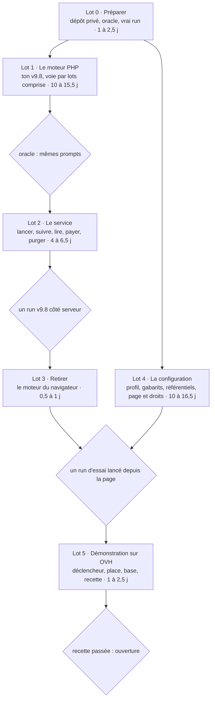

# Twin9 v9.8 : planning du moteur PHP et de la configuration

17 octobre 2026

## Le cap

Un seul moteur : ton v9.8, réécrit en PHP pour ta plateforme. Il se règle de bout en bout depuis une page de configuration, sans plafond imposé : budget et durée sont ceux que l'utilisateur choisit, ou aucun. Tout ce qui ne sert pas l'évaluation des élèves au regard du référentiel reste hors du produit.

| Directive | Ce que j'en fais |
| --- | --- |
| Partir de ton dépôt | Tout se fait dans `4nd4ny/humanome`, celui qui sert humanome.xyz, avec ta cartographie d'octobre et ton moteur JavaScript du v9.8. Le dépôt de Stéphane n'est ni forké ni modifié : on n'en reprend que des idées, réécrites, jamais de code, puisque son dépôt est privé et le tien public. Comme tu tiens Twin9 fermé pour l'instant, ton v9.8, ses gabarits et le moteur PHP vivent dans un dépôt privé, que la plateforme charge (lot 0). |
| Garder la version 9.8 | Ton Twin_v9 v9.8, réécrit en PHP fonction par fonction. Un oracle tiré de ton code vérifie, appel par appel, que le moteur PHP envoie les mêmes prompts que le tien. Écarts voulus, listés dans le test : trois correctifs du découpage (NFC, BOM, dates Google Docs) et un garde-fou mono-famille, repris de Stéphane, et un défaut de ton code corrigé : une panne mémorisée passait ensuite pour un jugement. |
| Tout coder en PHP | La plateforme fait tout : comptes, configuration, exécution des runs, résultats. Ton moteur du navigateur part une fois remplacé (lot 3). Ton Python ne sert qu'hors ligne, à produire l'oracle. |
| D'abord corriger | Les corrections se font dans le port, chacune avec son test : la panne mémorisée de ton code, et quatre exigences qu'aucun moteur côté serveur ne peut négliger (une clé par run, l'identité prise dans la session, le propriétaire vérifié à chaque lecture, le modèle réellement servi relevé). |
| Lever toutes les limitations | Aucun plafond d'instruction : ton v9.8 n'en a pas, le port n'en ajoute pas. Budget et durée sont des plafonds facultatifs, « aucun » compris. Les troncatures écrites dans ton code (900 et 4 000 caractères, 15 lignes) font partie de l'algorithme : elles restent, et deviennent des réglages. |
| Tout régler depuis une page de configuration | Chaque paramètre de ton `config.json`, plus le modèle Claude de chaque étape, le parallélisme, les clés, la voie directe ou par lots, les plafonds, le jeu de gabarits des promptologues et le référentiel des épistémiarques. |
| Être multi-référentiels | Le moteur ne suppose aucun référentiel : RESPIRE n'est que le premier publié, et chaque run choisit le sien. Ta cartographie d'octobre lit déjà le référentiel embarqué dans les données. Le planning n'en charge aucun autre ; la V18, comme les suivants, entrera par l'atelier des épistémiarques (lot 4). |
| Le minimalisme | Rien de ce que Stéphane a ajouté n'entre dans ton dépôt. Au lot 3 ne part que ton moteur du navigateur, une fois le moteur PHP en service. Ni Docker ni Caddy : on développe sans conteneurs, et la démonstration reste sur ton OVH gratuit (lot 5). |

Du dépôt de Stéphane, aucun code n'entre. On en reprend des idées, réécrites : trois correctifs du découpage, le garde-fou mono-famille, les journées en parallèle, la relance qui n'instruit que les journées nouvelles, le refus d'un code de compétence hors motif.

### Au crible du minimalisme

Relu à la lumière de tes corrections, le planning gardait encore des habitudes de production, importées par analogie. Elles sortent :

| Retiré ou simplifié | Pourquoi |
| --- | --- |
| La CI du dépôt privé, qui rejouait l'oracle sur le dépôt public | Les tests de parité tournent là où sont les gabarits, dans ta conversation de travail, et sautent ailleurs, comme ceux de ton moteur JavaScript. |
| Les fournisseurs OpenRouter, vLLM et Ollama, avec le refus de collecte et le contrôle du routage | La démonstration tourne sur ta clé Anthropic, et chaque étape choisit son modèle Claude. L'ADR-010 garde son adresse verrouillée ; un autre fournisseur attendra qu'on en ait besoin. |
| Les Fibers | Le rejeu suffit : chaque tranche relit le journal, collecte les appels en attente et rend la main. |
| Les plafonds mensuels, par utilisateur et par instance, et le rapprochement avec la facture du fournisseur | Ta directive : budget et durée par run, choisis par l'utilisateur. Tes crédits prépayés protègent déjà la clé de l'instance. |
| Les versions immuables des profils | Chaque run garde une copie de son profil : même trace, sans gestion de versions. |
| Brouillon, essai et publication des jeux de gabarits | Ton atelier a déjà versions et retour arrière : une copie qu'on choisit dans son profil suffit. |
| Sur la page : l'origine de chaque valeur, l'écart au profil v9.8, l'alerte de collège d'une seule famille | Une valeur modifiée se distingue de la valeur par défaut ; le reste encombre la page. |
| L'import des anciens runs Python dans la cartographie ; les cas de JSON de Twin6 | Hors du but : tes visionneuses Python lisent tes runs, et Twin6 marche. |
| L'état « à jour » ou « périmée » d'une carte | La mémoire de ta carte fait déjà la mise à jour ; la page dit seulement combien de journées sont nouvelles. |
| La garde de place au déploiement, la place restante affichée à l'administrateur | `deploy.mjs` affiche la place restante ; le poids d'un run se note dans la doc. |

Quatre limites restent, parce qu'elles ne viennent pas de l'algorithme : la capacité du serveur, le débit des fournisseurs, la fenêtre de contexte de chaque modèle et, avec la clé de l'instance, les crédits de l'utilisateur. Quand l'une d'elles retarde ou arrête un run, la page du run le dit (lot 2).

Ta question « pourquoi ne pas tout coder en PHP ? » tient : le moteur n'est qu'une suite d'appels d'API et d'accès à la base.

Ton dépôt a déjà ce moteur en JavaScript, au même protocole (`v9.8-contre-lecture`). Le faire tourner sur le serveur, dans un processus Node, ferait l'économie du port, soit sept à dix jours ; mais il faudrait l'adapter de même au serveur (journal, reprise, lots, fournisseurs), et la plateforme aurait deux langages serveur au lieu d'un. Je garde ton choix du tout PHP.

## Vue d'ensemble

Six lots, en deux colonnes qui se rejoignent à la recette de la configuration : environ 27 à 45 jours de travail, plus une marge de 20 %. Avec deux chantiers menés en parallèle, la durée tombe à celle du chemin du moteur (lots 0, 1, 2, 3 et 5) : 17 à 28 jours. Les prompts qui découpent ce travail en conversations suivent le lot 5.



*Total estimé : 27 à 45 jours de travail, plus 20 % de marge ; deux chantiers en parallèle, 17 à 28 jours. Le lot 4 commence dès le lot 0 ; ses référentiels attendent le lot 1, leur recette le lot 2.*

Le moteur (lots 1 à 3) et la plateforme (lot 4) avancent en même temps : le lot 4 n'attend le moteur que pour ses référentiels, et le service que pour leur recette. Chaque losange est une porte : le lot suivant ne commence que lorsqu'elle est franchie.

## Lot 0 · Préparer

Avant d'écrire une ligne de PHP : un dépôt privé pour ton v9.8, ses gabarits et le futur moteur ; un oracle qui dit si le moteur PHP joue bien ton v9.8 ; un vrai run, réponses comprises.

L'oracle est faisable. Ton moteur JavaScript a atteint en juillet la parité à l'octet des sorties de ton v9.8 (carte, profil, appels par étape) sur six oracles simulés, sans comparer les prompts ; je l'ai fait pour les prompts sur 13 scénarios de PLANT-01, où un dérivé Python de ton v9.8, réglé comme lui, en reproduit les 33 074 prompts à l'octet. Pour le PHP, l'oracle enregistre aussi chaque réponse : le moteur PHP les rejoue, si bien qu'il n'a pas à imiter ton simulé, et compare l'empreinte de chacun de ses prompts à celle du tien.

| Tâche | Où | Fait quand | Taille | Statut |
| --- | --- | --- | --- | --- |
| Ouvrir le chantier dans ton dépôt : une branche par prompt, fusionnée dans `main` par ta pull request, comme pour la cartographie. Écrire l'ADR-011 du moteur PHP (deux ADR portent déjà le numéro 010) : exécution sur le serveur par tranches (ADR-005), Anthropic seul, moteur dans `Twin_v9` que la plateforme charge, portfolio et état du run gardés sur le serveur avec l'accord de l'apprenant, coût moyen à la place du devis par run simulé ; une ligne en tête des ADR 001, 005, 008 et 010 renvoie à lui. `CLAUDE.md` : plus de Docker en développement, Composer local avec la plateforme fixée à PHP 8.2. La CI publique reçoit la suite php, avec MySQL. | `docs/decisions/`, `CLAUDE.md`, `.github/workflows/publiable.yml`, `STATUS.md` | La CI passe avec la suite php ; la plateforme démarre avec et sans `../Twin_v9`. | M | À faire |
| Créer `Twin_v9`, ton dépôt privé, que tu crées sous ton compte avec ton code v9.8 tel quel à sa racine, et y verser le générateur de l'oracle : il exécute ton code en simulé sur 13 scénarios de PLANT-01 (réglages, collèges, jurys, Arpenteur, reprise sur un état), sous une version de Python fixée, et enregistre chaque appel (chemin de son artefact, puisque tes jurés partagent une même étiquette ; étape ; empreinte du prompt ; réponse ou panne) et les sorties finales. Le dépôt se clone à côté de humanome, là où ses scripts le cherchent déjà (`gen-oracles.sh`, l'import des gabarits). | `Twin_v9` (`oracle/`) | Relancé, le générateur rend les mêmes fichiers, horodatages exceptés. | M | À faire |
| Enregistrer un vrai run de ton v9.8 sur PLANT-01, ton portfolio synthétique, avec les modèles que tu as choisis (Haiku, Sonnet), par le backend `anthropic` de ton code et une configuration à écrire : les tiennes visent Qwen et Mistral sur le HPC, ou Claude par la ligne de commande. Réponses comprises : un vrai modèle répond de façon plus désordonnée que le simulé, et c'est là que les analyseurs du port se jugent. Il reste dans `Twin_v9`, puisqu'une vraie réponse peut citer un gabarit. | `Twin_v9` (`oracle/reel/`) | Le run est versé, avec ses modèles et son coût. | S | À faire |

Taille estimée en jours de travail avec Claude, relectures comprises : S deux à quatre heures, M une demi-journée à une journée, L 2 à 3 jours, XL 5 à 10 jours. Repère : ton portage JavaScript du v9.8, parité des sorties comprise, a pris environ une journée mi-juillet ; le port PHP en reprend les assistants et les vecteurs.

Chaque tâche porte, dans le même commit, le test qui la vérifie ; pour le moteur, c'est l'oracle. Aucun test rouge n'est versé d'avance.

## Lot 1 · Le moteur PHP

Ton code, fonction par fonction et dans le même ordre, pour que chacune se relise contre la tienne : environ 4 400 lignes, `twin9.py` et `aurora/`, sans ton banc, tes outils HPC, ton simulé génératif ni tes visionneuses HTML. Ton moteur JavaScript sert de second guide : il a déjà répondu aux mêmes questions. L'oracle vérifie au fil de l'eau : une étape n'est finie que lorsque ses appels rendent tes prompts. Jusqu'au lot 4, le moteur lit les réglages de protocole de ton `config.json`, avec tes modèles fixés dans un fichier local. Le moteur vit dans `Twin_v9` ; la plateforme le charge et lui fournit les appels aux modèles, les clés et l'état du run.

| Tâche | Où | Fait quand | Taille | Statut |
| --- | --- | --- | --- | --- |
| Les fondations : découpage en journées, avec les trois correctifs de Stéphane (NFC, BOM, dates Google Docs), réécrits d'après leur description, les fins de ligne se convertissant comme le fait Python ; référentiel et fiches ; gabarits ; lecture tolérante du JSON ; ancrage des verbatims, qui exige un port exact de `difflib.SequenceMatcher`, `autojunk` compris ; empreintes et permutations ; tirage du jury aléatoire, qui exige un port exact du générateur de Python (`random.Random`). Et tout ce que Python fait autrement que PHP, jusqu'à l'octet des prompts : `round` à l'arrondi pair, `str()` des nombres à virgule, `json.dumps` dans le prompt du rapporteur, espaces Unicode, `strip` et tranches en caractères, ordre des ensembles dans les sommes de chaleur. Tes assistants `engine/src/twin9/py/` et leurs vecteurs ont résolu ces cas en juillet : ils se portent d'abord, avec les vecteurs dont les tests ont besoin. Aucune extension à ajouter chez OVH : les espaces Unicode viennent des tables de tes assistants, et la normalisation NFC d'un polyfill si l'extension `intl` y manque. | `Twin_v9` (`php/`) | Les vecteurs de ton moteur JavaScript passent en PHP ; gabarits et fiches rendus égalent les tiens, à l'octet (tests). | L | À faire |
| Les appels directs à Anthropic, côté plateforme, depuis ton `AnthropicCaller` : chaque étape choisit son modèle Claude ; délai et tentatives de ton code, réglables dans la limite d'une requête OVH ; un refus de débit attend son `Retry-After` ; budget de sortie, température par étape, modèle servi relevé. Le simulé rejoue les réponses de l'oracle. | `AnthropicCaller`, `Llm/` | Chaque requête est celle attendue (tests sur un fournisseur simulé). | S | À faire |
| La voie par lots, que tu as retenue pour un profil complet : les appels en attente de toutes les journées partent ensemble par l'API Message Batches d'Anthropic, à moitié prix, et le run reprend quand le lot revient. Un lot perdu dans un crash est retrouvé ; une erreur serveur est resoumise. C'est la voie qui convient à ton hébergement : une tranche soumet le lot et rend la main, une autre le relève. | `Llm/`, `Twin_v9` | Un run simulé par lots rend les mêmes prompts qu'en direct ; tué entre deux lots, il reprend sans rien repayer (tests). | M | À faire |
| La journée : lecteurs et calques (archives, élagage), consensus, première impression, greffier, juge léger et ses passes, contre-lecture, suspicions, carte du jour. Les calques archivés sont rangés par utilisateur, portfolio, référentiel et jeu de gabarits. | `journee.py` → `Twin_v9` | Les appels de la journée passent l'oracle sur les 13 scénarios. | L | À faire |
| Le tribunal : composition du jury dans ses trois modes (par défaut, socle de 4 et spécialiste du pôle ; socle 2+2 ; aléatoire), accusation, défense, réplique, briefing, jurés et second tour, relance, gardiens, président et ses prescriptions, dossier vide, faisceaux. | `tribunal9.py` → `Twin_v9` | Les appels du tribunal passent l'oracle. | L | À faire |
| La fusion : fusion mécanique, second ressort, profil ipsatif, relectures (Kairos, pôles, compétences, rapporteur), gardien des formulations, sorties (`carto_evolutive.json`, `profil_ipsatif.json`, rapports, carte de chaleur), sans tes visionneuses HTML. | `merge3.py`, `heatmap.py` → `Twin_v9` | Sorties identiques aux tiennes, horodatages et écarts voulus exceptés. | M | À faire |
| L'Arpenteur, à la demande comme chez toi. | `scan9.py` → `Twin_v9` | Le scénario avec Arpenteur passe l'oracle. | S | À faire |
| L'exécution, par tranches, puisque ton hébergement n'admet ni processus long ni cron : chaque tick (ADR-005, moins de 50 s) reprend les runs en attente là où ils s'étaient arrêtés, rejoue le moteur depuis le journal, envoie les appels suivants, en lot ou en direct s'ils tiennent dans la requête (ta démo en tient déjà de 150 s sur OVH), et rend la main. Il est déclenché de l'extérieur (lot 5) et par la page du run tant qu'elle est ouverte ; au plus N runs avancent à la fois, sous bail ; N et la durée d'une tranche sont des réglages de l'administrateur. Chaque run garde une copie de ses réglages. Chaque appel est inscrit au journal avant et après (identifiant de l'appel, étape, modèle servi, empreinte du prompt, réponse, jetons, coût, durée) ; à la reprise, une réponse ne sert que si le prompt recalculé a la même empreinte. Ce journal fait partie de l'état du run, sous l'accord de l'apprenant : ce n'est pas une journalisation, qui reste aux compteurs (ton principe 5), et un run fini n'en garde que les compteurs. Résultats et mémoire de la carte sont rangés compressés : en simulé, les 17 Mo de sorties d'un run de 10 journées en font 0,5. La mémoire de ta carte est rangée par utilisateur, portfolio, référentiel et jeu de gabarits, écrite journée par journée, et son empreinte couvre tout réglage qui change une réponse. Toute panne (lecteur, greffier, juge léger, contre-lecture, tribunal, second ressort) laisse sa journée ou son dossier à rejouer : la mémoire ne retient jamais une panne comme un jugement. Les parallélismes deviennent des réglages : ceux de ton code (lecteurs, compétences, jurés), plus les journées en parallèle, qui ne changent aucun prompt et remplissent les lots ; `curl_multi` sert les appels directs d'une tranche. Aucune transaction ne reste ouverte pendant une attente, et l'état se charge journée par journée, dans la mémoire que permet OVH. | `Worker/Tick.php`, `Worker/JobQueue.php`, la route `worker-tick`, migration, `Twin_v9` | Un run tué en plein tribunal reprend sans appel en double ; un juré en panne est rejoué au run suivant ; un rejeu dans un ordre mélangé rend les mêmes prompts ; deux runs simultanés gardent leurs réglages et leur clé ; aucune tranche ne dépasse sa durée (tests). | L | À faire |
| L'oracle en continu : les tests de parité lisent `../Twin_v9` et tournent dans ta conversation de travail avant chaque commit ; ailleurs, ils sautent proprement, comme ceux de ton moteur JavaScript aujourd'hui. Ils rejouent quatre scénarios simulés, dont l'Arpenteur et un jury aléatoire, plus le vrai run, et comparent les sorties en JSON décodé : l'ordre d'achèvement des appels n'y compte pas. | `Twin_v9`, `api/tests/Twin9/` | Un mot changé dans un prompt les fait échouer, en moins de deux minutes. | S | À faire |

## Lot 2 · Le service

Le moteur tourne ; ce lot le met entre les mains des utilisateurs : lancer, suivre, lire, payer, purger. Les vues Twin9 de ton dépôt restent ; elles lisent désormais le serveur, et ta cartographie d'octobre affiche les résultats.

| Tâche | Où | Fait quand | Taille | Statut |
| --- | --- | --- | --- | --- |
| Lancer et suivre un run : identité prise dans la session, profil choisi et copié dans le run, portfolio de l'utilisateur ou téléversé, accord de l'apprenant au lancement, qui étend au stockage ton écran de consentement (ADR-010) : son portfolio et l'état du run restent sur le serveur jusqu'à ce qu'il les efface (ton principe 2). L'écran, qui promet aujourd'hui que rien n'est conservé côté serveur, ta politique de confidentialité et ton registre RGPD le disent désormais. Progression lue dans le journal d'appels, avec ce qui retarde ou arrête le run (runs simultanés, débit du fournisseur, crédits) ; annulation, reprise ; la page du run déclenche le tick tant qu'elle est ouverte. | routes `twin9.php`, `JobQueue`, `Twin9View`, `content/legal/confidentialite.md`, `docs/rgpd-registre.md` | Un run lancé depuis le front va au bout, se suit et se reprend (test de bout en bout). | M | À faire |
| Lire les résultats par php : le propriétaire, et le cartographe qu'il a lié, avec la visibilité qu'il choisit ; l'administrateur ne voit que des compteurs. Comme dans ton v9.8, l'élève voit le dossier complet, délibérations comprises, pour suivre le déroulé du raisonnement : ta cartographie les montre déjà pour un run AuroraCore (jury, seconde lecture), et `mapper.js` les lui apportera pour un run Twin9. Le filtre de fuite des gabarits s'applique à ce qui s'affiche. | routes php, `LeakFilter`, `ResultatsTwin9`, `mapper.js`, `web/src/carto/` | Un run du serveur s'ouvre dans la cartographie, délibérations comprises ; personne ne lit le run d'un autre (tests d'accès). | L | À faire |
| Coûts et plafonds : chaque appel débite les crédits de son auteur à l'usage réel, ta marge comprise, à moitié prix par lots. Budget et durée par run, facultatifs, « aucun » possible : atteints, le run s'arrête proprement, carte marquée incomplète, reprise possible. Avant de lancer, l'utilisateur voit le coût moyen par journée des runs passés du même profil, à défaut celui du vrai run de PLANT-01 ; ce chiffre remplace le devis par run simulé de l'ADR-010. Le premier run d'un portfolio évalue toutes ses journées. | `CreditService`, `Twin9Config`, `Llm/`, page de lancement | Un run plafonné à 1 $ s'arrête à 1 $ et sa carte le dit (test). | M | À faire |
| Une clé par run : celle de l'utilisateur, tirée de son coffre, ou celle de l'instance, lue au moment de l'appel et jamais écrite ailleurs. | `KeyVault`, `Llm/` | Aucune clé dans le journal d'appels ni dans les sorties (test). | S | À faire |
| Relancer : un portfolio déjà évalué n'instruit que ses journées nouvelles ou changées, grâce à la mémoire de ta carte, puis la fusion se refait ; la page de lancement dit combien de journées sont nouvelles. Un retrait ne change rien : la carte reste additive, et l'interface de cartographie choisit les journées utilisées. | `Twin_v9`, page de lancement | Une journée ajoutée n'instruit qu'elle (test). | S | À faire |
| Purge et export : supprimer un compte (`DELETE /auth/account`) efface aussi ses runs, leur journal et la mémoire de ses cartes ; l'export du compte les contient. | `routes/auth.php`, export du compte | Après la purge, aucune ligne de l'utilisateur ne reste dans les tables du moteur (test). | S | À faire |

## Lot 3 · Retirer

Une fois le service passé à php, ton moteur du navigateur part d'un coup, sans rien réparer avant : réparer du code qu'on retire est du travail perdu. Le dépôt perd près de 9 000 lignes de JavaScript, sans compter leurs tests. Rien d'autre ne part : rien de ce que Stéphane a ajouté n'est entré.

| Tâche | Où | Fait quand | Taille | Statut |
| --- | --- | --- | --- | --- |
| Le moteur Twin9 du navigateur. D'abord, `mapper.js` et `parsePole` passent dans `web/`, avec ce qui les importe : la génération des fiches au build, `CartographyViewer`, `interface-handoff`, l'export `twin9` d'`engine/src/index.js`. Puis partent `engine/src/twin9/` (ses assistants `py/` compris, une fois portés), ses tests et vecteurs, `scripts/twin9/gen-oracles.sh` (remplacé par le générateur de `Twin_v9`), la part de `Twin9View` qui exécutait le run (reprise IndexedDB, devis simulé) et la route `/twin9/appel`, avec son test. `/twin9/meta` reste, réduite à ce que lisent les crédits et Twin6 (offre, packs, solde, référentiel). Le reste de ces fichiers sert les crédits, PayPal, l'atelier et `/twin6/appel` : il reste. | `engine/`, `scripts/extract-fiches.mjs`, `web/src/views/Twin9View.jsx`, `web/src/views/twin9/`, `web/src/api/twin9.js`, `api/src/routes/twin9.php`, `scripts/twin9/` | La suite « moteur », la suite php et `npm run build` passent ; crédits, atelier, Twin6 et cartographie marchent toujours. | S | À faire |
| La documentation : `CLAUDE.md`, `docs/twin9/` (les spécifications du portage JavaScript deviennent celles du moteur PHP), `STATUS.md`. | `CLAUDE.md`, `docs/` | Aucune commande documentée ne vise ce qui est parti. | S | À faire |

## Lot 4 · La configuration

Un profil, enregistré dans php, décrit un run de bout en bout, et le moteur l'exécute tel quel. Moteur et plateforme ne faisant plus qu'un, il n'y a plus rien à exporter ni à transmettre : le moteur lit profil, gabarits et référentiel dans la base. Ce lot peut commencer dès le lot 0 ; ses référentiels (4c) attendent le moteur PHP, qu'ils modifient, et leur recette attend le service.

### 4a · Le profil

| Tâche | Où | Fait quand | Taille | Statut |
| --- | --- | --- | --- | --- |
| Écrire le contrat du profil : chaque paramètre de ton `config.json`, troncatures comprises ; le collège des lecteurs et le modèle Claude de chaque autre étape (première impression, greffier, juge léger, contre-lecture, accusation, défense, réplique, briefing, jurés, relance, second tour, gardiens, président, second ressort, relectures, Arpenteur), l'étage servant de valeur par défaut ; la voie, directe ou par lots ; le parallélisme ; budget et durée ; la référence de clé ; le jeu de gabarits ; le référentiel. Toute clé inconnue est refusée. | `schemas/twin9-profil.schema.json`, `docs/contrats.md` | Aucun paramètre de ton config.json ne manque au schéma, et le moteur ne lit que lui (tests). | M | À faire |
| Ranger les profils dans php, modifiables. Par défaut, le profil v9.8 avec tes choix : Haiku aux lecteurs et à l'analyse rapide, Sonnet à l'analyse profonde, ta clé Anthropic, la voie par lots. Puis les profils de chacun. Chaque run garde une copie de son profil et cite la version de son jeu de gabarits et de son référentiel : c'est son attestation. | migration, routes php | Un profil invalide est refusé ; un profil valide sert au run suivant (tests). | S | À faire |

### 4b · Les gabarits des promptologues

| Tâche | Où | Fait quand | Taille | Statut |
| --- | --- | --- | --- | --- |
| Jeux de gabarits dans ton atelier : un promptologue habilité copie le jeu v9.8, qui reste en lecture seule, édite sa copie avec les versions et le retour arrière qui existent déjà, et la choisit dans son profil ; l'administrateur fixe le jeu par défaut. Une variable qu'aucune étape ne fournit est refusée à l'enregistrement. Aujourd'hui, seuls les comptes à la fois administrateur et promptologue voient les gabarits (D2) ; l'ouvrir à tout promptologue est à trancher (hors planning). | `ProtocoleRepository`, routes de l'atelier, `Twin9AtelierView` | Un mot changé dans une copie se retrouve dans le prompt rendu ; le jeu v9.8 ne change jamais (tests). | M | À faire |

### 4c · Les référentiels des épistémiarques

| Tâche | Où | Fait quand | Taille | Statut |
| --- | --- | --- | --- | --- |
| Laisser la gouvernance porter plusieurs référentiels : tout y est verrouillé sur RESPIRE, 7 pôles et 61 compétences, au point qu'un brouillon de 5 pôles ne peut pas s'enregistrer. L'épistémiarque importe un référentiel et dit à quel niveau il se lit (la capacité plutôt que la facette, par exemple) ; un code qui ne suit pas le motif déclaré est refusé, puisque sa compétence disparaîtrait sans bruit du run. Un brouillon ne sert qu'aux runs d'essai de son auteur. | `ReferentielRepository`, `schemas/referentiel.schema.json`, validateurs compilés, `routes/annotations.php` | Un référentiel d'une autre structure que RESPIRE (5 pôles lettrés, codes A1 à E4) s'enregistre, se vote et se publie. | L | À faire |
| Lever les hypothèses RESPIRE de ton code : pôles numérotés de 1 à 7 et codes au format `1.01` (`POLE_NOMS`, motif des codes, `range(1, 8)`), profil ipsatif à 7 pôles, spécialistes et paires du jury rangés par numéro de pôle. Le « 61 » et les exemples de codes écrits dans tes gabarits deviennent des variables, qui rendent pour RESPIRE le texte d'origine. Le moteur prend le référentiel du run dans la base, ta source unique de juillet, qui génère déjà les fiches : un référentiel y déclare ses pôles, leurs noms et le motif de ses codes. | `Twin_v9`, `FicheGenerator`, gabarits `merge/`, `scan/`, `tagger/` | Un référentiel à pôles lettrés et codes A1 à E4, et un autre à 9 pôles, passent la fusion ; RESPIRE reste identique à l'octet (oracle). | L | À faire |
| Le visualiseur : ta cartographie d'octobre lit déjà le référentiel embarqué dans les données, sans rien de codé en dur ; le chemin qui y mène, lui, est verrouillé sur 7 pôles. `mapper.js` passe par le document de fusion, dont les couleurs (`merge-document.js`) et les schémas (`cartographie-merge`, `cartographie-jour`, `competence`) n'admettent que les pôles 1 à 7 et les codes `1.01`, et la cartographie veut des numéros de pôle entiers. Un pôle lettré reçoit un numéro d'ordre, la palette et les huit marques de pôle se prolongent, et chaque changement de format se documente dans `docs/contrats.md`. | `mapper.js`, `engine/src/pipeline/merge-document.js`, `schemas/`, `web/src/carto/core/referential.js`, `docs/contrats.md` | Une carte à 5 pôles lettrés s'affiche avec leurs noms, une à 9 pôles aussi. | L | À faire |
| Recette : sur un même portfolio, RESPIRE et un référentiel de test d'une autre structure traversent le moteur, la fusion et le visualiseur sans rien partager : mémoire de la carte, calques, attestation. | tests de bout en bout | Les deux cartes coexistent, chacune avec son référentiel. | M | À faire |

### 4d · La page

| Tâche | Où | Fait quand | Taille | Statut |
| --- | --- | --- | --- | --- |
| Construire la page `#/configuration` à partir du schéma du profil : une section par partie ; une valeur modifiée se distingue de la valeur par défaut, rien de plus. Base : tes réglages d'administration Twin9 et ton atelier des gabarits. | `Twin9AtelierView`, `web/src/views/admin/`, routes php des profils, `Twin9Config` | Aucun réglage de l'algorithme ne reste hors de la page. | L | À faire |
| Droits par rôle : chacun règle ses profils, son budget, sa durée et sa clé, et choisit parmi les référentiels publiés ; le promptologue peut y mettre son jeu de gabarits, l'épistémiarque son brouillon de référentiel ; l'administrateur fixe la clé et les prix de l'instance. | `RequireRole`, `docs/autorisations.md`, `Twin9Config` | La matrice des droits est écrite et testée. | M | À faire |

Aucun référentiel n'est privilégié : RESPIRE n'est que le premier publié, et chaque run choisit le sien. Le planning n'en charge aucun autre ; les épistémiarques publient les leurs par l'atelier.

## Lot 5 · Démonstration sur ton OVH

humanome.xyz reste sur ton hébergement gratuit d'OVH, comme ta question 41 l'avait tranché : ni Infomaniak, ni Docker, ni Caddy, puisqu'OVH sert déjà Apache, PHP 8.2 et le certificat. Le moteur en tient les contraintes dès le lot 1 : pas de processus long, pas de cron, 100 Mo de disque, dont 56 occupés après le ménage du 16 octobre. Le code y pèse à peine plus : le port ajoute moins d'un mégaoctet, et ton moteur JavaScript quitte le bundle du front. Les données des runs vont dans ta base MySQL, qui vit sur un autre de tes hébergements OVH, avec son propre quota. Pour la démonstration, le portfolio passe par le serveur avec l'accord de l'apprenant ; le régime des établissements attendra la production.

| Tâche | Où | Fait quand | Taille | Statut |
| --- | --- | --- | --- | --- |
| Le déclencheur : ton offre n'a pas de cron. Un service externe gratuit appelle `POST /api/admin/worker-tick`, qui existe déjà, toutes les quelques minutes avec son jeton ; la page du run le relaie tant qu'elle est ouverte. | `docs/deploiement.md`, page du run | Un run lancé puis laissé seul va au bout, navigateur fermé. | S | À faire |
| La place : la release embarque le moteur de `../Twin_v9`, hors du webroot ; `deploy.mjs` garde ses trois dernières releases et affiche la place restante. | `scripts/deploy/deploy.mjs` | Après un envoi, la place restante s'affiche. | S | À faire |
| La base : les migrations du moteur, puis la graine : tes 22 gabarits par ton import d'administration (ADR-010), en version figée « v9.8 », et RESPIRE avec ses fiches. Le quota de la base, relevé dans ton panel, et le poids d'un vrai run se notent dans `docs/hebergement.md` ; ses sauvegardes automatiques et `backup-db.mjs` couvrent déjà ces tables. | migration, `scripts/twin9/import-protocole.mjs`, `docs/hebergement.md` | Les gabarits rendus en production égalent ceux de la v9.8 ; quota et poids d'un run sont notés. | S | À faire |
| Recette sur humanome.xyz : parcours complet (compte, configuration, run par lots, résultats, partage, purge), puis ouverture de la démonstration. | humanome.xyz, liste de recette dans `docs/` | Tu as déroulé la recette sans écart bloquant. | M | À faire |

Au passage en production, hors de ce planning : un serveur distinct (ta question 41), qui admettra des processus longs pour des runs plus rapides et plus nombreux ; le chiffrement au repos de la base ; pour les établissements, le régime proposé : consentement explicite, pseudonymisation avant envoi à un tiers, portfolio effacé en fin de run sauf accord.

## Les prompts

Une conversation par prompt, dans l'ordre ci-dessous. Chaque prompt renvoie à ce planning, rangé dans ton dépôt sous `docs/plan-twin9-php.md`, plutôt que de le recopier. En fin de conversation : tests verts, `STATUS.md` à jour, une pull request que tu fusionnes.

### Avant de commencer

- Fusionner la pull request qui verse ce planning dans ton dépôt : chaque prompt le lit.
- Créer `4nd4ny/Twin_v9`, privé, avec ton dossier Twin_v9 v9.8 tel quel à sa racine.
- Ouvrir chaque conversation avec les deux dépôts, Twin_v9 cloné à côté de humanome (`../Twin_v9`), là où ses scripts le cherchent déjà.
- Pour T2 : une clé Anthropic fournie par l'environnement de la conversation.
- Pour T16 : ton panel OVH et un service gratuit de tâches planifiées.

### Règles communes

1. Lire d'abord `CLAUDE.md`, `STATUS.md` et la partie du planning que le prompt cite.
2. Rien de la v9.8 n'entre dans humanome : code de référence, gabarits, fiches et enregistrements restent dans `Twin_v9`. `node scripts/check-publiable.mjs` passe avant chaque commit.
3. Les tests qui ont besoin de la v9.8 lisent `../Twin_v9` et sautent proprement s'il manque.
4. Pas de Docker : PHP local, Composer avec la plateforme fixée à PHP 8.2 ; la suite php complète, qui a besoin de MySQL, tourne dans la CI.
5. Contraintes d'OVH gratuit : pas de processus long (tranches de moins de 50 s), pas de cron, 100 Mo de disque, base MySQL distante.
6. Minimalisme : rien hors du périmètre du prompt ; aucune dépendance, option, métrique ou infrastructure que le planning ne demande pas. Une idée utile se note dans `STATUS.md`, elle ne se code pas.
7. Documentation et interface en français ; code, commits et identifiants en anglais ; un commit par lot cohérent, tests verts avant chaque commit.
8. `assets-existants/` en lecture seule ; aucun secret dans un fichier versionné ; `.env.deploy` ne s'ouvre jamais ; aucun déploiement sans le feu vert de Christian.
9. Une branche par prompt (`feat/twin9-tN-…`) et une pull request vers `main` ; Christian fusionne.

### Ordre

Moteur : T0, T1, puis T3 à T11 ; T2 se place après T1, avant la fin de T6. Plateforme, en parallèle : T12 dès T0, T13 après T12, T14 après T6, T15 après T14 et T9. T9 attend aussi T12, dont il lance les profils ; T16 vient en dernier, les deux colonnes finies. Pour T3, T4, T7 et T14, le prompt demande d'abord un plan, que tu valides.

### T0 · Ouvrir le chantier

```
Applique les règles communes de docs/plan-twin9-php.md. Lis le cap et le
lot 0 du planning, puis les ADR 001, 005, 008 et 010 de docs/decisions/.

Objectif : poser le cadre du moteur PHP de Twin9, sans écrire le moteur.

1. ADR-011 « Moteur Twin9 v9.8 en PHP » : la v9.8 réécrite en PHP,
   exécutée sur le serveur par tranches, par le tick de l'ADR-005 ;
   appels à Anthropic seul, en direct ou par lots ; le moteur vit dans
   le dépôt privé Twin_v9 et la plateforme le charge ; le portfolio et
   l'état du run sont gardés sur le serveur avec l'accord de
   l'apprenant ; le coût moyen remplace le devis par run simulé. En
   tête des ADR 001, 005, 008 et 010, une ligne « Amendé par ADR-011 »
   qui dit quoi.
2. CLAUDE.md : plus de Docker en développement ; PHP local, Composer
   avec la plateforme fixée à 8.2 ; la suite php complète tourne dans
   la CI ; les runs Twin9 tournent sur le serveur (ADR-011) ; commandes
   mises à jour.
3. CI publique : un job php (PHP 8.2, MySQL en service) qui lance la
   suite existante.
4. Le chargeur : la plateforme charge le moteur depuis
   ../Twin_v9/php/src s'il est là (autoload PSR-4) ; sinon, Twin9 côté
   serveur reste désactivé et ses tests sautent. Dans ../Twin_v9, à
   côté de mon code v9.8 : php/composer.json (PHP 8.2, PHPUnit) et
   php/src/ avec une classe vide et son test.

DoD : CI verte avec le job php ; la plateforme démarre avec et sans
../Twin_v9 ; check-publiable passe ; une pull request par dépôt.

Interdits : aucun code du moteur ; rien de la v9.8 dans humanome.
```

### T1 · L'oracle de la v9.8

```
Applique les règles communes de docs/plan-twin9-php.md (lot 0, tâche
« Créer Twin_v9 »). Travaille dans ../Twin_v9, qui contient mon code
v9.8 tel quel.

Objectif : l'oracle qui dira, appel par appel, si le moteur PHP rend
les prompts de la v9.8.

1. oracle/generate.py, sous une version de Python fixée et notée :
   exécute mon code en simulé (--mock) sans le modifier, en enveloppant
   son backend simulé, sur 13 scénarios, tous sur PLANT-01 : réglages
   par défaut ; configuration et collège cloud ; Arpenteur global, avec
   et sans eux ; un autre sel ; sans état ; un autre collège
   (--models qwen32b:3) ; deux collèges sans famille déclarée, écrits
   dans oracle/ (un modèle en trois passes ; deux passes et un second
   modèle) ; une reprise sur l'état laissé par le premier scénario ;
   trois passes du juge léger sans contre-lecture ; jurys aléatoire et
   socle 2+2.
2. Pour chaque appel : chemin de son artefact, étape, empreinte SHA-256
   du prompt, réponse ou panne ; puis les sorties finales
   (carto_evolutive.json, profil_ipsatif.json, cartes des journées).
   Les prompts complets ne sont pas versionnés : le générateur les
   réécrit à la demande, hors du dépôt, pour examiner un écart.
3. oracle/README.md : comment régénérer, ce que couvre chaque
   scénario.

DoD : deux générations successives rendent les mêmes fichiers,
horodatages exceptés ; pull request dans Twin_v9.

Interdits : modifier mon code v9.8 (tout ce qui n'est ni oracle/ ni
php/) ; écrire dans humanome.
```

### T2 · Le vrai run de PLANT-01

```
Applique les règles communes de docs/plan-twin9-php.md (lot 0, tâche
« Enregistrer un vrai run »). Travaille dans ../Twin_v9. La clé
Anthropic vient de l'environnement (ANTHROPIC_API_KEY) : ne l'écris
nulle part.

1. oracle/config-reel.json et son collège : le backend anthropic de
   mon code ; trois lectures Haiku (famille anthropic), autant que mon
   collège par défaut a de lecteurs ; Haiku à l'analyse rapide et en
   model_mini, Sonnet à l'analyse profonde ; les modèles de la
   génération courante (claude-haiku-5-5 et claude-sonnet-5-5 à ce
   jour).
2. Estime le coût du run sur PLANT-01 et attends mon accord avant de
   le lancer.
3. Lance-le avec l'enregistreur de T1, étendu pour relever dans chaque
   réponse le modèle servi et les jetons, sans modifier mon code ;
   verse dans oracle/reel/ chaque appel et les sorties ; note le coût
   et la durée dans oracle/README.md.

DoD : oracle/reel/ complet, coût réel noté ; pull request dans
Twin_v9.

Interdits : relancer sans mon accord ; garder une réponse réelle hors
de Twin_v9.
```

### T3 · Les fondations du moteur

```
Applique les règles communes de docs/plan-twin9-php.md (lot 1, tâche
« Les fondations »). Travaille dans ../Twin_v9/php/. Guides : mon code
(aurora/util.py, portfolio.py, referentiel.py, templates.py) et, dans
humanome, engine/src/twin9/py/ et engine/test/twin9-vectors/.

D'abord un plan : les fonctions à porter, dans l'ordre, et leurs
tests ; attends ma validation.

Puis porte les assistants Python (difflib.SequenceMatcher autojunk
compris, random.Random, round à l'arrondi pair, str() des flottants,
json.dumps, espaces Unicode, strip et tranches en caractères, ordre des
ensembles, empreintes) ; le découpage en journées avec les trois
correctifs (NFC, BOM, dates Google Docs), les fins de ligne converties
comme le fait Python ; référentiel et fiches ; gabarits ; lecture
tolérante du JSON ; ancrage des verbatims ; empreintes et permutations.
Copie dans Twin_v9 les vecteurs dont tes tests ont besoin : ceux de
humanome partiront au lot 3.

DoD : les vecteurs passent en PHP ; gabarits et fiches rendus égalent
ceux de mon code, à l'octet ; les variantes de PLANT-01 (en NFD, un BOM
devant le premier titre, les dates à la Google Docs) rendent ses dix
journées, aux mêmes dates ; aucune extension hors du cœur de PHP
(polyfill si intl manque) ; pull request dans Twin_v9.

Interdits : toute étape du pipeline (journée, tribunal, fusion).
```

### T4 · Le modèle d'appel et la journée

```
Applique les règles communes de docs/plan-twin9-php.md (lot 1 : « La
journée », et « L'exécution » pour le rejeu). Travaille dans
../Twin_v9/php/. Référence : aurora/journee.py.

D'abord un plan ; attends ma validation.

1. Le modèle d'appel : chaque appel a un identifiant (le chemin de son
   artefact), une étape et l'empreinte de son prompt. Le moteur
   s'exécute en rejeu : il lit les réponses connues, collecte toutes
   les demandes sans réponse des branches parallèles (journées, pôles,
   jurés), puis s'arrête. Pas de Fibers : des boucles et une exception
   « en attente » qui agrège les demandes.
2. Un fournisseur simulé qui rejoue les réponses de l'oracle.
3. La journée : lecteurs et calques, consensus, première impression,
   greffier, juge léger et ses passes, contre-lecture, suspicions,
   carte du jour, avec le garde-fou mono-famille. Une panne laisse la
   journée à rejouer ; elle n'est jamais mémorisée comme un jugement.

DoD : sur les 13 scénarios, chaque appel de la journée a l'empreinte
de l'oracle, quel que soit l'ordre du rejeu ; un collège en plusieurs
passes d'un même modèle, sans famille déclarée, compte pour une seule
famille ; une panne simulée laisse la journée à rejouer (tests) ; pull
request dans Twin_v9.
```

### T5 · Le tribunal

```
Applique les règles communes de docs/plan-twin9-php.md (lot 1, tâche
« Le tribunal »). Travaille dans ../Twin_v9/php/. Référence :
aurora/tribunal9.py.

Porte la composition du jury dans ses trois modes (socle de 4 et
spécialiste du pôle, socle 2+2, aléatoire), l'accusation, la défense,
la réplique, le briefing, les jurés et le second tour, la relance, les
gardiens, le président et ses prescriptions, le dossier vide, les
faisceaux.

DoD : les appels du tribunal ont les empreintes de l'oracle sur les 13
scénarios, jurys 2+2 et aléatoire compris ; pull request dans Twin_v9.
```

### T6 · La fusion et l'Arpenteur

```
Applique les règles communes de docs/plan-twin9-php.md (lot 1 : « La
fusion », « L'Arpenteur »). Travaille dans ../Twin_v9/php/.
Références : aurora/merge3.py, heatmap.py, scan9.py.

Porte la fusion mécanique, le second ressort, le profil ipsatif, les
relectures (Kairos, pôles, compétences, rapporteur), le gardien des
formulations, la carte de chaleur et les sorties (carto_evolutive.json,
profil_ipsatif.json, rapports), puis l'Arpenteur à la demande. Pas de
visionneuse HTML. Les troncatures de la v9.8 deviennent des réglages, à
leurs valeurs d'origine.

DoD : l'oracle complet passe : mêmes empreintes pour tous les appels
des 13 scénarios, sorties identiques en JSON décodé, horodatages et
écarts voulus exceptés, chacun nommé dans le test ; le vrai run de
PLANT-01, rejoué, rend les mêmes sorties ; pull request dans Twin_v9.
```

### T7 · L'exécution par tranches

```
Applique les règles communes de docs/plan-twin9-php.md (lot 1 :
« L'exécution », « Les appels directs à Anthropic », « L'oracle en
continu »). Travaille dans humanome. Contexte : ADR-005, ADR-011,
docs/hebergement.md.

D'abord un plan ; attends ma validation.

1. Migration MySQL : runs (avec la copie de leurs réglages), journal
   d'appels, mémoire de la carte (par utilisateur, portfolio,
   référentiel et jeu de gabarits), résultats ; résultats et mémoire
   compressés ; un run fini ne garde du journal que ses compteurs.
2. Le tick (Worker/Tick.php, route worker-tick) avance les runs par
   tranches de moins de 50 s : bail par run, au plus N runs à la fois
   (N et la durée d'une tranche réglés par l'administrateur dans la
   configuration Twin9), rejeu du moteur depuis le journal, envoi des
   demandes en attente, réponses enregistrées ; une réponse ne sert que
   si l'empreinte du prompt recalculé correspond.
3. Les appels directs à Anthropic, depuis AnthropicCaller et Llm/ :
   curl_multi dans la tranche, modèle Claude de chaque étape, budget de
   sortie, température, tentatives et Retry-After, modèle servi
   relevé ; la clé du run lue au moment de l'appel.
4. Les tests de parité (api/tests/Twin9/) : ils lisent ../Twin_v9,
   rejouent à travers le tick quatre scénarios simulés, dont
   l'Arpenteur et un jury aléatoire, plus le vrai run, et comparent les
   sorties en JSON décodé ; sans ../Twin_v9, ils sautent.

DoD : un run simulé va au bout en tranches ; tué en plein tribunal, il
reprend sans appel en double ; deux runs simultanés gardent leurs
réglages et leur clé ; aucune tranche ne dépasse sa durée ; un mot
changé dans un gabarit fait échouer les tests de parité en moins de
deux minutes (tests) ; pull request.
```

### T8 · La voie par lots

```
Applique les règles communes de docs/plan-twin9-php.md (lot 1, tâche
« La voie par lots »). Travaille dans humanome.

Les demandes en attente de toutes les journées partent ensemble par
l'API Message Batches d'Anthropic : une tranche soumet le lot, une
tranche suivante le relève. Un lot perdu est retrouvé par son
identifiant, une erreur serveur est resoumise, et le coût de chaque
appel vient de l'usage rendu, à moitié prix.

DoD : un run simulé par lots rend les mêmes prompts qu'en direct ; tué
entre deux lots, il reprend sans rien repayer (tests sur un fournisseur
de lots simulé) ; pull request.
```

### T9 · Lancer, suivre, lire

```
Applique les règles communes de docs/plan-twin9-php.md (lot 2 :
« Lancer et suivre », « Lire les résultats »). Travaille dans humanome,
une fois T12 fusionné. Contexte : docs/autorisations.md, ADR-010,
content/legal/confidentialite.md.

1. Lancer : identité prise dans la session ; profil choisi, copié dans
   le run, dont le moteur lit les réglages au lieu du config.json ;
   portfolio de l'utilisateur ou téléversé ; accord de l'apprenant pour
   garder son portfolio et l'état du run sur le serveur. L'écran de
   consentement de Twin9View, la politique de confidentialité et
   docs/rgpd-registre.md le disent.
2. Suivre : progression lue dans le journal, avec ce qui retarde ou
   arrête le run (runs simultanés, débit du fournisseur, crédits) ;
   annulation, reprise ; la page du run déclenche le tick tant qu'elle
   est ouverte.
3. Lire : résultats servis au propriétaire et au cartographe qu'il a
   lié, avec la visibilité qu'il choisit ; l'administrateur ne voit que
   des compteurs ; LeakFilter sur ce qui s'affiche ; mapper.js apporte à
   la cartographie le dossier complet, délibérations comprises.

DoD : un run lancé depuis le front va au bout, se suit, se reprend et
s'ouvre dans la cartographie (test de bout en bout en simulé, avec des
gabarits de test) ; le moteur ne lit que des réglages du schéma ;
personne ne lit le run d'un autre (tests d'accès) ; pull request.
```

### T10 · Coûts, clés, relance, purge

```
Applique les règles communes de docs/plan-twin9-php.md (lot 2 : coûts,
clé, relance, purge). Travaille dans humanome.

1. Coûts : chaque appel débite les crédits de son auteur à l'usage
   réel, marge comprise, à moitié prix par lots. Budget et durée par
   run, facultatifs, « aucun » possible : atteints, le run s'arrête
   proprement, sa carte marquée incomplète, reprise possible. Avant de
   lancer : le coût moyen par journée des runs passés du même profil, à
   défaut celui du vrai run de PLANT-01.
2. Une clé par run : celle de l'utilisateur (son coffre) ou celle de
   l'instance, jamais écrite dans le journal ni dans les sorties.
3. Relance : un portfolio déjà évalué n'instruit que ses journées
   nouvelles ou changées ; la page le dit avant de lancer.
4. Purge et export : DELETE /auth/account efface aussi les runs, leur
   journal et la mémoire des cartes ; l'export du compte les contient.

DoD : un run plafonné à 1 $ s'arrête à 1 $ et le dit ; aucune clé dans
le journal ; une journée ajoutée n'instruit qu'elle ; après purge,
aucune ligne de l'utilisateur dans les tables du moteur (tests) ; pull
request.
```

### T11 · Retirer le moteur du navigateur

```
Applique les règles communes de docs/plan-twin9-php.md (lot 3).
Travaille dans humanome, une fois T9 fusionné.

1. Déplace mapper.js et parsePole dans web/, avec ce qui les importe :
   scripts/extract-fiches.mjs, CartographyViewer, interface-handoff,
   l'export twin9 d'engine/src/index.js.
2. Retire engine/src/twin9/, ses tests et ses vecteurs,
   scripts/twin9/gen-oracles.sh, la part de Twin9View qui exécutait le
   run (reprise IndexedDB, devis simulé), la route /twin9/appel et son
   test ; /twin9/meta reste, réduite à ce que lisent les crédits et
   Twin6.
3. Mets à jour CLAUDE.md, docs/twin9/ et STATUS.md.

DoD : suites moteur, front et php vertes ; npm run build passe ;
crédits, atelier, Twin6 et cartographie marchent toujours ; pull
request.
```

### T12 · Le profil et la page de configuration

```
Applique les règles communes de docs/plan-twin9-php.md (lot 4 : 4a et
4d). Travaille dans humanome. Contexte : Twin9Config, l'administration
Twin9, Twin9AtelierView, docs/autorisations.md ; une interface qui
n'affiche que ce dont l'utilisateur a besoin, quand il en a besoin.

1. schemas/twin9-profil.schema.json et docs/contrats.md : chaque
   paramètre du config.json de la v9.8, troncatures comprises ; le
   modèle Claude de chaque étape, l'étage servant de valeur par défaut ;
   la voie ; le parallélisme ; budget et durée ; la référence de clé ;
   le jeu de gabarits ; le référentiel. Toute clé inconnue est refusée.
2. Les profils en base, modifiables ; par défaut, mon profil v9.8
   (Haiku aux lecteurs et à l'analyse rapide, Sonnet à l'analyse
   profonde, voie par lots).
3. La page #/configuration, construite depuis le schéma : une section
   par partie ; une valeur modifiée se distingue de la valeur par
   défaut ; rien d'autre.
4. Les droits : chacun règle ses profils et sa clé, et choisit parmi
   les référentiels publiés ; le promptologue peut y mettre son jeu de
   gabarits, l'épistémiarque son brouillon de référentiel ;
   l'administrateur fixe la clé et les prix de l'instance.

DoD : aucun paramètre du config.json de la v9.8 ne manque au schéma ;
un profil invalide est refusé, un profil valide s'enregistre et se
relit ; la matrice des droits est testée ; pull request.
```

### T13 · Les jeux de gabarits

```
Applique les règles communes de docs/plan-twin9-php.md (lot 4 : 4b).
Travaille dans humanome. Contexte : ProtocoleRepository,
Twin9AtelierView, la décision D2 de STATUS.md et ma réponse à la
question « Qui voit les gabarits ? » ; sans réponse, D2 s'applique.

Un promptologue habilité copie le jeu v9.8, qui reste en lecture seule,
édite sa copie avec les versions et le retour arrière de l'atelier, et
la choisit dans son profil ; l'administrateur fixe le jeu par défaut.
Une variable qu'aucune étape ne fournit est refusée à l'enregistrement.

DoD : un mot changé dans une copie se retrouve dans le prompt rendu ;
le jeu v9.8 ne change jamais (tests) ; pull request.
```

### T14 · Plusieurs référentiels : gouvernance et moteur

```
Applique les règles communes de docs/plan-twin9-php.md (lot 4 : 4c,
deux premières tâches). Travaille dans humanome et ../Twin_v9.
Contexte : schemas/referentiel.schema.json, ReferentielRepository,
FicheGenerator, la gouvernance des épistémiarques.

D'abord un plan ; attends ma validation.

1. La gouvernance accepte un référentiel de toute structure (nombre de
   pôles, codes lettrés) : l'épistémiarque l'importe et choisit le
   niveau qui tient lieu de compétence ; un code hors du motif déclaré
   est refusé ; un brouillon sert aux runs d'essai de son auteur.
2. Le moteur lève les hypothèses RESPIRE (POLE_NOMS, motif des codes,
   range(1, 8), profil ipsatif à 7 pôles, spécialistes et paires du
   jury par numéro de pôle) ; le « 61 » et les exemples de codes des
   gabarits deviennent des variables qui rendent, pour RESPIRE, le
   texte d'origine.

DoD : un référentiel à 5 pôles lettrés (codes A1 à E4) s'enregistre,
se vote, se publie et passe la fusion, un autre à 9 pôles aussi ;
RESPIRE reste identique à l'octet (oracle) ; une pull request par
dépôt.
```

### T15 · Plusieurs référentiels : la cartographie

```
Applique les règles communes de docs/plan-twin9-php.md (lot 4 : 4c,
deux dernières tâches). Travaille dans humanome.

1. Le chemin vers la cartographie n'admet que 7 pôles :
   engine/src/pipeline/merge-document.js (couleurs), les schémas
   cartographie-merge, cartographie-jour et competence (pôles 1 à 7,
   codes 1.01), web/src/carto/core/referential.js (numéros entiers). Un
   pôle lettré reçoit un numéro d'ordre ; palette et marques de pôle se
   prolongent au-delà de huit ; chaque changement de format est noté
   dans docs/contrats.md.
2. Recette : sur un même portfolio, RESPIRE et un référentiel de test
   d'une autre structure traversent moteur, fusion et cartographie sans
   rien partager (mémoire, calques, copie du profil).

DoD : une carte à 5 pôles lettrés et une à 9 pôles s'affichent avec
leurs noms ; les deux cartes coexistent (tests de bout en bout) ; pull
request.
```

### T16 · La démonstration sur ton OVH

```
Applique les règles communes de docs/plan-twin9-php.md (lot 5). Lis
docs/hebergement.md et docs/deploiement.md. Ce prompt prépare : je
fais moi-même les gestes dans mon panel OVH et dans le service de
tâches planifiées, et je donne mon feu vert à chaque déploiement.

1. Le déclencheur : docs/deploiement.md explique comment faire appeler
   POST /api/admin/worker-tick toutes les quelques minutes par un
   service gratuit, avec son jeton, que je saisis moi-même.
2. La place : la release embarque le moteur de ../Twin_v9, hors du
   webroot ; deploy.mjs garde ses trois releases et affiche la place
   restante.
3. La base : migrations du moteur ; puis la graine : les 22 gabarits
   v9.8 par l'import d'administration, en version figée « v9.8 », et
   RESPIRE avec ses fiches ; le quota de la base, que je relève, et le
   poids d'un vrai run, notés dans docs/hebergement.md.
4. Recette sur humanome.xyz, avec moi : compte, configuration, run par
   lots, résultats, partage, purge ; puis ouverture de la
   démonstration.

DoD : un run lancé puis laissé seul va au bout, navigateur fermé ; la
recette est déroulée sans écart bloquant ; pull request.

Interdits : déployer sans mon feu vert ; ouvrir .env.deploy ; écrire un
secret dans un fichier versionné.
```

### Reprise

Quand un prompt déborde sur plusieurs conversations :

```
Lis CLAUDE.md, STATUS.md et docs/plan-twin9-php.md. Résume en cinq
lignes l'état du chantier et ce qui reste du prompt T__. Propose un
plan pour le finir ; n'écris aucun code avant ma validation.
```

## Hors planning

Deux questions restent ouvertes, sans bloquer le départ ; les autres sont tranchées.

| Question | En attendant | Ma proposition |
| --- | --- | --- |
| **Publier le moteur PHP ?** Tu tiens Twin9 fermé pour l'instant ; or ton dépôt est public, et ton moteur JavaScript du v9.8 y est lisible depuis juillet : son retrait au lot 3 ne l'efface pas de l'historique. | Le moteur vit dans `Twin_v9`. À trancher avant T0. | Le garder fermé protège ses évolutions, pas la v9.8 déjà lisible. Le jour où tu publies Twin9, il passe dans ton dépôt tel quel ; les gabarits, eux, restent privés (ADR-010). Seul auteur des deux dépôts, tu n'es pas lié par l'AGPL de ton propre code (je ne suis pas juriste). |
| **Qui voit les gabarits v9.8 ?** Aujourd'hui, les seuls comptes à la fois administrateur et promptologue (D2). | D2 s'applique : l'atelier Twin9 reste à ces comptes. À trancher avant T13. | Tout promptologue que l'administrateur habilite, comme le veut ta directive sur le choix des prompts : partant d'une copie du jeu v9.8, il le voit. |

Tranché le 17 octobre :

- **Le dépôt** : le tien, `4nd4ny/humanome` ; celui de Stéphane n'est ni forké ni modifié.
- **Hébergement** : la démonstration reste sur ton OVH gratuit, sans Docker ni Caddy ; un autre serveur attendra la production.
- **Données de l'apprenant** : pour la démonstration, le portfolio et l'état du run sont gardés sur le serveur, avec l'accord de l'apprenant à chaque lancement ; le régime proposé pour les établissements attend la production.
- **Journée retirée** : la carte reste additive, comme dans ton v9.8 ; l'interface de cartographie choisit les journées utilisées.
- **Collège** : tes modèles par défaut ; la page de configuration permet de tout changer.
- **Modes de jury** : aléatoire et « socle 2+2 » sont des paramètres de l'algorithme, donc portés (lot 1).
- **Guides sur la noèsiologie** : ils restent, puisque ce n'est qu'un court portail vers De Humani Cerebri Fabrica, sans le détail des fonctions ni la liste des stratégies.
- **Protocole d'essai v8.18** : son §12 est réglé.

Avec ce planning, la plateforme n'a plus qu'un moteur Twin9 et un seul langage serveur. Ton code reste la référence : s'il évolue, l'oracle se régénère et dit au moteur PHP ce qu'il doit suivre.
